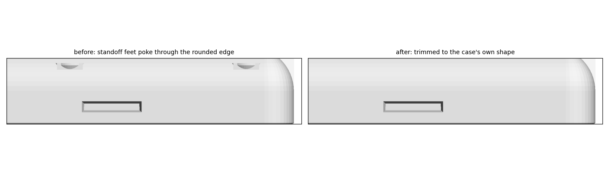

# Case files

Modified from **"Lilygo T-Deck TD1 Case" by Alley Cat**, Printables model 741124,
https://www.printables.com/model/741124-lilygo-t-deck-td1-case, licensed
[CC BY-SA 4.0](https://creativecommons.org/licenses/by-sa/4.0/). The STL files and images in this folder are
changed versions of that design and are shared under the same licence, CC BY-SA 4.0. The originals are on
Printables. (The script in `scripts/` is MIT, like the rest of the repository.)

| File | What it is | Changed from |
|---|---|---|
| [stl/front-earpiece-mic.stl](stl/front-earpiece-mic.stl) | Front, with earpiece grille, mic pocket, a second SMA antenna cut-out, the unused switch mount filled, and Alley Cat's cat-head logo on the top-edge badge | `Alley Chat TD1 Standard Front GPS Inserts.stl` |
| [stl/test-prints/test-mic-coupon.stl](stl/test-prints/test-mic-coupon.stl) | Small test print: 18 mm of the bottom wall around the mic pocket | the front above |
| [stl/test-prints/test-fit-ring-100.stl](stl/test-prints/test-fit-ring-100.stl), [test-fit-ring-101.stl](stl/test-prints/test-fit-ring-101.stl) | Test prints for the T-Deck's fit: the front's screen frame and walls, 9 mm tall, at 100 % and 101 % | the front above |
| [stl/earpiece-holder.stl](stl/earpiece-holder.stl) | Small block that fills the earpiece pocket and holds the earpiece on the grille slot | new part, sized to the front's pocket |
| [stl/back-modem-gps.stl](stl/back-modem-gps.stl) | Back with modem standoffs, SIM slit, GPS patch cradle, network-LED window, the back's half of the old GPS-module slot filled, and the rushiWorks logo on the outside (first version: print and dry-fit) | `Alley Chat TD1 X Back Outside Cat Edition.stl` |

Alley Cat's small parts are included **unchanged**, copied from the same Printables download (same licence and
credit), so everything to print is in [stl/](stl/):

| File | What it is | Original file |
|---|---|---|
| [stl/alley-chat-td1-switch.stl](stl/alley-chat-td1-switch.stl) | Slider for the T-Deck's own power switch (right side). Needed | `Alley Chat TD1 Switch.stl` |
| [stl/alley-chat-td1-reset-button.stl](stl/alley-chat-td1-reset-button.stl) | Button for the T-Deck's reset (left side). Needed if you want to reach reset from outside | `Alley Chat TD1 Reset Button.stl` |
| [stl/alley-chat-td1-x-antenna-plug.stl](stl/alley-chat-td1-x-antenna-plug.stl) | Blanks off an SMA hole that has no connector in it. **Not needed in this build:** both holes carry an SMA connector (LoRa top-left, 4G top-right) | `Alley Chat TD1 X Antenna Plug.stl` |

**Folders:** [stl/](stl/) has the parts to print, and [stl/test-prints/](stl/test-prints/) the small test pieces to print
first. [images/](images/) holds the pictures in these notes, [logo/](logo/) the two logos the scripts engrave, and
[scripts/](scripts/) the programs that make the STL files and pictures.

**Assembly diagrams** (what every cut-out is for, and where each part goes) and the step-by-step assembly order are in
[../docs/assembly.md](../docs/assembly.md).

## Front: what changed

Only these changes were made. The outer size and everything else are exactly as the original.

**Earpiece grille.** A 1 × 6 mm slot with rounded ends goes through the 3.6 mm face above the screen. It is
centred under the GPS pocket, which measures 16.4 × 7.3 mm inside.

- The receiver (the Micromax one) lies on the pocket floor, facing the slot, with its rubber gasket against the floor.
  It is 12 × 6 mm and 2 mm thick with the gasket. Its two spring contacts, folded over its back at the short
  ends, make it 3 mm.
- The [earpiece holder](#earpiece-holder) goes in on top of it and keeps it pressed down.

**Microphone.** In the bottom edge, 15 mm left of the USB-C opening as you look at the screen. This is the corner
that points toward your mouth when the phone is at your right ear.

- **The mic:** Sunrom 6027 ([sunrom.com/m/5522](https://www.sunrom.com/m/5522)). Its datasheet gives:
  - **Body:** Ø6.0 ± 0.2 mm, 2.7 ± 0.2 mm tall.
  - **Pins:** two, 2.8 mm long, 0.4 mm thick, 1.9 mm apart.
- **Pocket:** 6.3 mm round, opening on the inside of the case. That leaves 0.1–0.5 mm of play around the mic. Its top
  is pointed (a "teardrop") so it prints without supports.
- **Skin and sound hole:** 1.2 mm of plastic is left at the outside, with a 1.5 mm sound hole through it.
- **Fitting the mic, before the T-Deck goes in:** the pocket opens on the inside face of the bottom wall, which
  the T-Deck covers once it's in. Push the Sunrom 6027 (6 × 2.7 mm) in from inside until it touches the skin. Hold
  it with a dab of glue, lay its wires in the groove, then fit the T-Deck.
- **Wire groove:** a 2.4 mm groove runs from the pocket up the inside wall and through the mating lip, so the
  two mic wires reach the back half without the T-Deck pinching them.
- **Pins and wires:**
  - **Space behind the mic:** the pocket stays open behind the mic body all the way into the case. The only thing
    nearby is the T-Deck's back edge, which reaches 1.3 mm up the pocket's lower (screen-side) edge.
  - **Turn the mic so its two pins sit side by side,** both at the mic's centre height, level with each other and
    parallel to the screen. Then both solder joints are 1.7 mm clear of the T-Deck, and in line with the groove.
  - **Trim the pins to about 1.5 mm,** solder a thin wire to each, and bend the wires up into the groove. Don't let a
    joint hang toward the screen side.

**Alley Cat's cat-head logo on the top-edge badge.** It's a visible credit to the case's designer.

- **Badge:** the original badge (cat ears + GPS pin) is replaced by a fresh one of the same footprint: a 1 mm raised
  pad with 45° bevels and a 16.8 × 10.5 mm face.
- **The cat:** the cat head is taken from Alley Cat's own TD1 files, and is the same cat as on her *Alley Chat HT
  Pocket* case (see [logo/](logo/)). It's 9.4 mm tall and cut the same way as on the HT Pocket: the head recessed
  0.35 mm, the closed eyes and nose 0.7 mm deep.
- **Orientation:** it reads upright when the phone lies screen-up, with the ears toward the screen side.


**Unused switch mount filled.** The GPS version's slide-switch mount on the left side (a window and two
countersunk screw holes) isn't used, because the modem follows the T-Deck's power switch. It is filled
completely, including the recess for the switch body on the inside. The fill copies the wall's normal shape from
just beside the mount, so inside and out the wall now matches the rest of the side, where the T-Deck already fits.
The Reset Button opening just below stays, with its small inside recess for the button's flange. So does a small
original bump on the inside wall below the old switch, up to 0.8 mm high.

**Second SMA antenna cut-out (top-right corner).** The Grove socket is desoldered from the T-Deck and the modem
wires are soldered to its pads, so the Grove plug slot in that corner is no longer needed. It is filled in, and the
corner gets an exact mirror image of the case's own SMA cut-out from the top-left corner. Its fit with the KTRON
IPX → SMA-female cable (KSTA0380):

| Cut-out (both corners) | Size | KTRON connector | Fit |
|---|---|---|---|
| Hole through the wall | Ø 6.56 mm | SMA thread 6.35 mm | ✓ 0.2 mm clearance |
| Hex pocket on the inside, 3 mm deep | 8.4 mm across flats | 8 mm hex collar | ✓ snug, and stops it turning when the antenna is tightened |
| Nut recess on the outside, 2.8 mm deep | Ø 12 mm | 8 mm nut + lock washer | ✓ sits just below the surface |
| Wall | 2 mm | 9.5 mm thread (typical) | leaves about 4.7 mm outside for the antenna. Measure yours: it needs at least 9 mm |

- **Check on the T-Deck before printing:** the case's wall block in that corner is 7.8 mm deep. The connector's
  hex collar, crimp and heat-shrink reach about 11–16 mm in from the outer surface. So 3–8 mm of it goes past the
  T-Deck's top edge, level with the T-Deck's back surface. With the Grove socket removed, hold the connector in
  that corner and check that nothing on the T-Deck is in the way. In the top-left corner, the LoRa connector already
  uses the same space.
- **Which antenna where:** see below.

Both top corners now have identical SMA cut-outs, so either antenna can go in either corner. **Recommended:** 4G
in the top-right (old Grove corner), and the T-Deck's LoRa connector staying top-left, where it already sits.
From the top-right, the 4G cable drops straight into the empty strip beside the modem board, to its 4G socket on
that side (about 4 cm; the 10 cm cable is plenty). From the top-left, it would have to get around the battery,
which covers the board with only about 1 mm to spare (about 11 cm, so use the 15 cm cable).

## Earpiece holder

[stl/earpiece-holder.stl](stl/earpiece-holder.stl) is a new printed part, 16.0 × 6.9 × 16.5 mm. It fills the front's old
GPS-module pocket and keeps the earpiece pressed onto the grille slot. In the GPS version of the case, the
module's slot ran from the front up into the back. The back's half is now filled solid (see the back changes
below), so the holder only fills the front's part.


- **Cup:** the earpiece sits in a 12.4 mm long cup on the holder's underside, over the slot.
  - **Sides:** the holder is only 6.9 mm wide, too narrow for a wall on both sides of a 6 mm earpiece. So the cup
    has a 0.7 mm wall on the T-Deck side only, and is open on the far side. There the pocket's own wall holds the
    earpiece, with 6.4 mm of room between the two walls.
  - **Middle:** the cup is 1.7 mm deep here, and the holder presses on the middle of the earpiece's back. That squeezes
    the 2 mm body and gasket 0.3 mm onto the pocket floor, sealing the sound path to the slot.
  - **Ends:** over the last 3 mm at each end the cup is 3.5 mm deep. That leaves room for the folded contacts (1 mm)
    and their solder joints.
- **Held by the back:** the holder stands on the pocket floor, and its top ends 0.1 mm under the back's filled block.
  Once the case is closed, it can't lift.
- **Wires:** each end pocket has its own 2 mm groove up the face toward the T-Deck. Each wire goes straight up from
  its solder joint, then over the T-Deck to the modem.
- **Fit:** 0.2 mm clearance all round in the pocket. The script checks that it touches neither case half.
- **If your earpiece measures differently:** the length and width are set at the top of
  `scripts/make_earpiece_holder.py` (`EAR_L`, `EAR_W`). Change them and run it again.
- **Printing:** lay it on the face with the wire grooves (the face toward the T-Deck). Then no supports are needed.

## Back: what changed

**Outside.** Made from Alley Cat's *Outside Cat* edition of the X back. It has the same vertical grooves, with the
three middle ones shortened, which leaves a clear area near the top. That area had a cat-head outline engraved in
it. The cat is filled flush, and the **rushiWorks logo** is engraved in its place:

- **Size:** 24 × 17 mm, 1 mm deep, matching the grooves. The letter strokes are about 0.8 mm wide.
- **Clearances:** it stays clear of the grooves and of the two case-screw countersinks.
- **Orientation:** it reads normally when you look at the back with the phone upright.
- **Printing:** the back prints face-down, so the logo forms in the first layers and comes out crisp.
- **Inside:** identical to the Inside Cat edition, so all the changes below are the same with either.
- **Inside floor:** Alley Cat's engraved cat head and "Alley Chat TD1 X" text (hidden once assembled) are filled
  flat. The designer is credited by the badge kept on the front's top edge and in the README.


**Old GPS-module slot filled.** The GPS version's module slot continued from the front's pocket up into the back:
16.4 × 6.1 mm, 10 mm tall, in the thick block between the two case-screw holes. Only the earpiece uses the
front's part of it now, so the back's part is filled solid. The fill copies the block's cross-section from just beside
the slot, so the block now runs unbroken between the screw holes and caps the earpiece holder.

**Modem standoffs.** Four columns at the KTRON board's holes.

- **Board:** the KTRON is 54.33 × 57.23 mm, with its holes on a 47.90 × 50.70 mm rectangle.
- **Columns:** 7 mm wide, with a 10 mm foot, and their tops 9 mm above the inside floor. The two next to the left
  wall are joined to it.
- **Trimmed to the case's shape:** the cover's bottom edge is rounded, so near the floor its outside face curves in.
  The two left columns' feet used to poke up to 1.5 mm out through that curve. Everything added to the back is now
  trimmed to the original cover's outer shape, so nothing shows outside (fixed 6 Nov 2026).

  
- **Inserts:** each column has a 4.5 mm hole, 6 mm deep, for an M3 × 5 heat-set insert. The board is held with
  M3 × 6 screws from its solder side.
- **Board orientation:** component side down toward the back cover. The SIM edge faces the phone's left side,
  0.6 mm from the wall. The 4G socket faces right, and the GPS socket is at the bottom, just above the patch.
- **9 mm only works after the capacitor swap.** The KTRON's two 11 mm tall capacitors are replaced by radial
  ones laid flat (see [../docs/bring-up.md](../docs/bring-up.md), phase B). Nothing on the board's component side
  may stand more than 8 mm high.

**SIM slit.** Through the left side wall, in line with the SIM holder.

- **Size:** 15 × 1.8 mm on the inside, flaring to about 16 × 3 mm on the outside so the card finds its way in.
- **Position:** its centre is 11.35 mm above the inside floor and 4.65 mm below the rim, so it is entirely in the
  back panel. That is the card's height in a standard 1.5 mm push-push micro-SIM holder sitting on a board on 9 mm
  standoffs.
- **Using it:** push the card in until it clicks, using a fingernail or a SIM pin. Push again to release it, then
  pull it out.
- **SIM size:** a nano-SIM in a micro adapter can catch in push-push holders. A fresh multi-cut SIM, popped out at
  micro size, is safer.

The SIM slit is shown from outside in the "after" half of the picture under *Modem standoffs* above.

**GPS patch cradle.** A fence with a 27 mm square opening near the bottom. It is sized for the measured patch:
26 × 26 mm board and a 25 × 25 × 4 mm ceramic that sits slightly crooked.

- **Pads:** the ceramic faces down and rests on four 3 mm pads, 0.5 mm high, so it stays just off the cover.
- **Fence:** 7 mm tall.
- **Cable notches:** 4 mm wide, in every side, for the cable that leaves the middle of one side of the board.
- **Fixing:** a dab of hot glue at two corners. The 95 mm cable easily reaches the GPS socket about 6 mm away.

**Network LED window.** The KTRON's network LED (NETLIGHT) faces the back cover from 9 mm up.

- **Light tube:** 3.6 mm bore, from the floor to 1.6 mm under the board, so the light goes straight out and the
  power LED next to it doesn't leak through.
- **Hole:** 1.6 mm through the cover, on the flat floor of the decorative groove beside the LED (1 mm thick there).
- **Where it shows:** near the top of the back, on the phone's right side. When you look at the back, that's the
  top-left area.
- **Blink pattern** (SIMCom): lit steadily while searching for the network; 200 ms on / 200 ms off once
  registered.
- **Optional:** a drop of clear glue or UV resin seals the hole and spreads the light.

**Depth** (inside floor to the T-Deck's back, 23 mm with LilyGO's 11 mm T-Deck): 9 standoffs + 1.6 board + 1.5 SIM
holder + 1 foam + 9 battery = 22.1 mm. The battery (65 × 55 × 9 mm) lies over the board, its long side running top
to bottom, with its connector end toward the bottom, over the patch.

## Fit and scale: print the test ring first

**The T-Deck's fit is tight on purpose.** For the first 5 mm above the screen face, the front's inside is exactly
68.00 mm wide. That's LilyGO's width for the T-Deck, with no clearance. Above that, a 1.5 mm tall ridge narrows it to
67.4–67.5 mm. The ridge snaps over the T-Deck's sides and holds it without screws, and the case is meant to flex as
the T-Deck goes in. So whether it fits depends on how your printer and filament come out, to a few tenths of a
millimetre.

**What other builders report** (Printables comments, 2024–2026):
- Most printed at 100 % in PETG, PLA, PLA+ or ABS and say it "fits like a glove". The designer uses PETG.
- Those printing ASA needed 0.5–1 % larger. ASA shrinks more as it cools.
- One printed at 102 % and needed a shim to stop the T-Deck shifting, so 102 % was too big for them.
- The designer's own advice: "if it's too tight, print it slightly larger".
- It does **not** fit the T-Deck Plus, which is a different, larger device (115 × 72 × 20 mm). This case is for the
  original T-Deck (100 × 68 × 11 mm).

**What to do:**
1. **Print the test ring at 100 %:** `stl/test-prints/test-fit-ring-100.stl`, screen side down, in the filament you'll use for the
   case. It takes about an hour.
2. **Try the fit:** clean the inside edges, then press the T-Deck in screen first, without forcing it.
   - **Right:** it needs a firm push, the ring flexes slightly, it clicks in, and it doesn't rattle.
   - **Too tight:** it won't go in without a lot of force.
   - **Too loose:** it drops in or wobbles.
3. **If it's too tight:** print `stl/test-prints/test-fit-ring-101.stl` and try again.
4. **If it's right at 100 %:** print the case files as they are.

**Don't scale the finished case files in the slicer.** Scaling the whole file also moves the parts we added: at
101 %, the modem standoffs would be 0.5 mm further apart than the board's holes. The M3 screws have only 0.2 mm of
play in those holes, so they wouldn't line up. If the test says 101 %, the scripts will be changed to enlarge only
Alley Cat's shell and keep our parts true to size.

## Printing

- Print the files as they are oriented, outer face down on the bed (the screen side for the front), with no
  supports. The earpiece slot is vertical, the mic pocket has a 45° roof, and the back's standoffs and cradle grow
  straight up.
- PLA+ or PETG, 0.2 mm layers, 3 perimeters, 20 % infill.
- The earpiece holder is the exception: lay it on its wire-groove face (see [Earpiece holder](#earpiece-holder)).
- In the slicer preview, check that the 1 mm slot and the 1.5 mm sound hole are open.
- **Print the fit-test ring first** (see [Fit and scale](#fit-and-scale-print-the-test-ring-first)).
- **Print `stl/test-prints/test-mic-coupon.stl` before the front** (a few minutes). Check that the mic slides in and sits against the skin. If
  it's too tight or too loose, the pocket size can be changed in the script.

## Making the front again

`scripts/make_front.py` makes the front from the original Printables file. All sizes are set at the top of the
script. It needs Python with numpy, trimesh, shapely and manifold3d:

```
python scripts/make_front.py "Alley Chat TD1 Standard Front GPS Inserts.stl" stl/front-earpiece-mic.stl
python scripts/make_back.py "Alley Chat TD1 X Back Outside Cat Edition.stl" stl/back-modem-gps.stl images/back-layout.png
python scripts/make_earpiece_holder.py stl/earpiece-holder.stl images/earpiece-holder.png stl/front-earpiece-mic.stl stl/back-modem-gps.stl
python scripts/make_fit_test.py stl/front-earpiece-mic.stl stl/test-prints
python scripts/make_diagrams.py stl/front-earpiece-mic.stl stl/back-modem-gps.stl images
```

The back script reads the logo from `logo/rushi-logo.jpg`, and also needs pillow and matplotlib to trace it.
