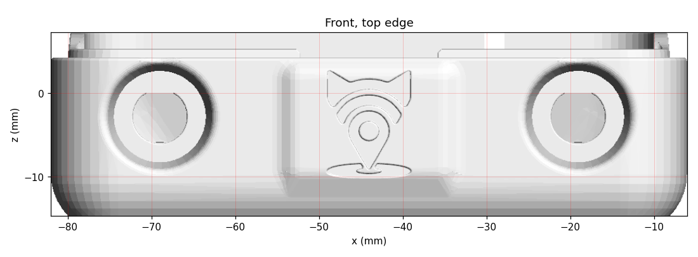

# Case files

Modified from **"Lilygo T-Deck TD1 Case" by Alley Cat**, Printables model 741124,
https://www.printables.com/model/741124-lilygo-t-deck-td1-case, licensed
[CC BY-SA 4.0](https://creativecommons.org/licenses/by-sa/4.0/). The STL files and images in this folder are
changed versions of that design and are shared under the same licence, CC BY-SA 4.0. The originals are on
Printables. (The script in `scripts/` is MIT, like the rest of the repository.)

| File | What it is | Changed from |
|---|---|---|
| [front-earpiece-mic.stl](front-earpiece-mic.stl) | Front, with earpiece grille, mic pocket and a second SMA antenna cut-out | `Alley Chat TD1 Standard Front GPS Inserts.stl` |
| [test-mic-coupon.stl](test-mic-coupon.stl) | Small test print: 18 mm of the bottom wall around the mic pocket | the front above |
| [back-modem-gps.stl](back-modem-gps.stl) | Back with modem standoffs, SIM slit and GPS patch cradle (first version: print and dry-fit) | `Alley Chat TD1 X Back Inside Cat Edition.stl` |

The other parts (Switch, Antenna Plug, Reset Button) are unchanged, so print those from the Printables download.

**Assembly diagrams** (what every cut-out is for, and where each part goes) and the step-by-step assembly order are in
[../docs/assembly.md](../docs/assembly.md).

## Front: what changed

Only these changes were made. The outer size and everything else are exactly as the original.

**Earpiece grille.** A 1 × 6 mm slot with rounded ends goes through the 3.6 mm face above the screen. It is
centred under the GPS pocket, which measures 16.4 × 7.3 mm inside.

- The receiver lies on the pocket floor, facing the slot.
- Its foam ring goes between it and the floor, and foam behind it keeps it pressed down.
- **The receiver has to fit inside 16.4 × 7.3 mm.** Measure the Micromax receiver before printing.

**Microphone.** In the bottom edge, 15 mm left of the USB-C opening as you look at the screen. This is the corner
that points toward your mouth when the phone is at your right ear.

- **Pocket:** 6.3 mm round, opening on the inside of the case. Its top is pointed (a "teardrop") so it prints
  without supports.
- **Skin and sound hole:** 1.2 mm of plastic is left at the outside, with a 1.5 mm sound hole through it.
- **Fitting the mic, before the T-Deck goes in:** the pocket opens on the inside face of the bottom wall, which
  the T-Deck covers once it's in. Push the Sunrom 6027 (6 × 2.7 mm) in from inside until it touches the skin. Hold
  it with a dab of glue, lay its wires in the groove, then fit the T-Deck.
- **Wire groove:** a 2.4 mm groove runs from the pocket up the inside wall and through the mating lip, so the
  two mic wires reach the back half without the T-Deck pinching them.
- **Before soldering:** trim the mic's pins short and bend the wires flat. There are 1.5–3.7 mm behind the mic
  before the inside surface of the wall.

**Second SMA antenna cut-out (top-right corner).** The Grove socket is desoldered from the T-Deck and the modem
wires are soldered to its pads, so the Grove plug slot in that corner is no longer needed. It is filled in, and the
corner gets an exact mirror image of the case's own SMA cut-out from the top-left corner. Its fit with the KTRON
IPX → SMA-female cable (KSTA0380):

| Cut-out (both corners) | Size | KTRON connector | Fit |
|---|---|---|---|
| Hole through the wall | Ø 6.56 mm | SMA thread 6.35 mm | ✓ 0.2 mm clearance |
| Hex pocket on the inside, 3 mm deep | 8.4 mm across flats | 8 mm hex collar | ✓ snug, and stops it turning when the antenna is tightened |
| Nut recess on the outside, 2.8 mm deep | Ø 12 mm | 8 mm nut + lock washer | ✓ sits just below the surface |
| Wall | 2 mm | 9.5 mm thread (typical) | leaves about 4.7 mm outside for the antenna. Measure yours: it needs at least 9 mm |

- **Check on the T-Deck before printing:** the case's wall block in that corner is 7.8 mm deep. The connector's
  hex collar, crimp and heat-shrink reach about 11–16 mm in from the outer surface. So 3–8 mm of it goes past the
  T-Deck's top edge, level with the T-Deck's back surface. With the Grove socket removed, hold the connector in
  that corner and check that nothing on the T-Deck is in the way. In the top-left corner, the LoRa connector already
  uses the same space.
- **Which antenna where:** see below.

Both top corners now have identical SMA cut-outs, so either antenna can go in either corner. **Recommended:** 4G
in the top-right (old Grove corner), and the T-Deck's LoRa connector staying top-left, where it already sits.
From the top-right, the 4G cable drops straight into the empty strip beside the modem board, to its 4G socket on
that side (about 4 cm; the 10 cm cable is plenty). From the top-left, it would have to get around the battery,
which covers the board with only about 1 mm to spare (about 11 cm, so use the 15 cm cable).




## Back: what changed


**Modem standoffs.** Four columns at the KTRON board's holes.

- **Board:** the KTRON is 54.33 × 57.23 mm, with its holes on a 47.90 × 50.70 mm rectangle.
- **Columns:** 7 mm wide, with a 10 mm foot, and their tops 9 mm above the inside floor. The two next to the left
  wall are joined to it.
- **Inserts:** each column has a 4.5 mm hole, 6 mm deep, for an M3 × 5 heat-set insert. The board is held with
  M3 × 6 screws from its solder side.
- **Board orientation:** component side down toward the back cover. The SIM edge faces the phone's left side,
  0.6 mm from the wall. The 4G socket faces right, and the GPS socket is at the bottom, just above the patch.
- **9 mm only works after the capacitor swap.** The KTRON's two 11 mm tall capacitors are replaced by radial
  ones laid flat (see [../docs/bring-up.md](../docs/bring-up.md), phase B). Nothing on the board's component side
  may stand more than 8 mm high.

**SIM slit.** Through the left side wall, in line with the SIM holder.

- **Size:** 15 × 1.8 mm on the inside, flaring to about 16 × 3 mm on the outside so the card finds its way in.
- **Position:** its centre is 11.35 mm above the inside floor and 4.65 mm below the rim, so it is entirely in the
  back panel. That is the card's height in a standard 1.5 mm push-push micro-SIM holder sitting on a board on 9 mm
  standoffs.
- **Using it:** push the card in until it clicks, using a fingernail or a SIM pin. Push again to release it, then
  pull it out.
- **SIM size:** a nano-SIM in a micro adapter can catch in push-push holders. A fresh multi-cut SIM, popped out at
  micro size, is safer.


**GPS patch cradle.** A fence with a 27 mm square opening near the bottom. It is sized for the measured patch:
26 × 26 mm board and a 25 × 25 × 4 mm ceramic that sits slightly crooked.

- **Pads:** the ceramic faces down and rests on four 3 mm pads, 0.5 mm high, so it stays just off the cover.
- **Fence:** 7 mm tall.
- **Cable notches:** 4 mm wide, in every side, for the cable that leaves the middle of one side of the board.
- **Fixing:** a dab of hot glue at two corners. The 95 mm cable easily reaches the GPS socket about 6 mm away.

**Depth** (inside floor to the T-Deck's back, 23 mm with LilyGO's 11 mm T-Deck): 9 standoffs + 1.6 board + 1.5 SIM
holder + 1 foam + 9 battery = 22.1 mm. The battery (65 × 55 × 9 mm) lies over the board, its long side running top
to bottom, with its connector end toward the bottom, over the patch.

## Printing

- Print the files as they are oriented, outer face down on the bed (the screen side for the front), with no
  supports. The earpiece slot is vertical, the mic pocket has a 45° roof, and the back's standoffs and cradle grow
  straight up.
- PLA+ or PETG, 0.2 mm layers, 3 perimeters, 20 % infill.
- In the slicer preview, check that the 1 mm slot and the 1.5 mm sound hole are open.
- **Print `test-mic-coupon.stl` first** (a few minutes). Check that the mic slides in and sits against the skin. If
  it's too tight or too loose, the pocket size can be changed in the script.

## Making the front again

`scripts/make_front.py` makes the front from the original Printables file. All sizes are set at the top of the
script. It needs Python with numpy, trimesh, shapely and manifold3d:

```
python scripts/make_front.py "Alley Chat TD1 Standard Front GPS Inserts.stl" front-earpiece-mic.stl
```
