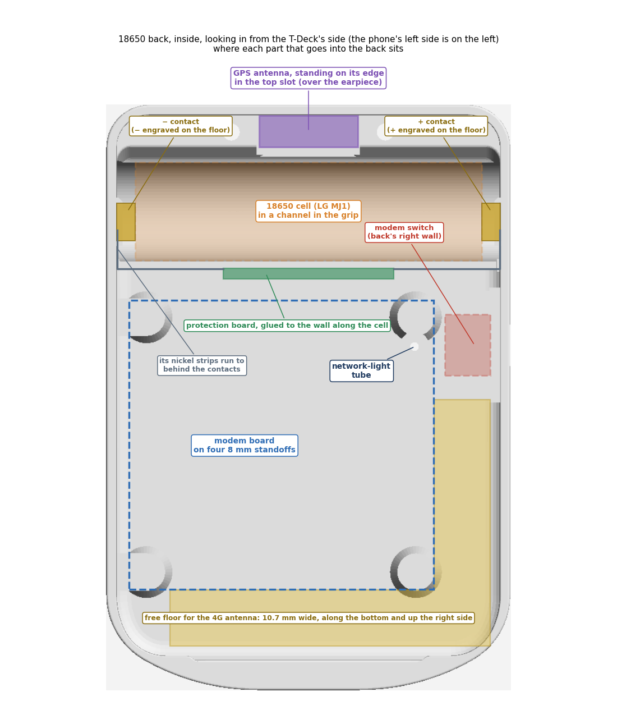
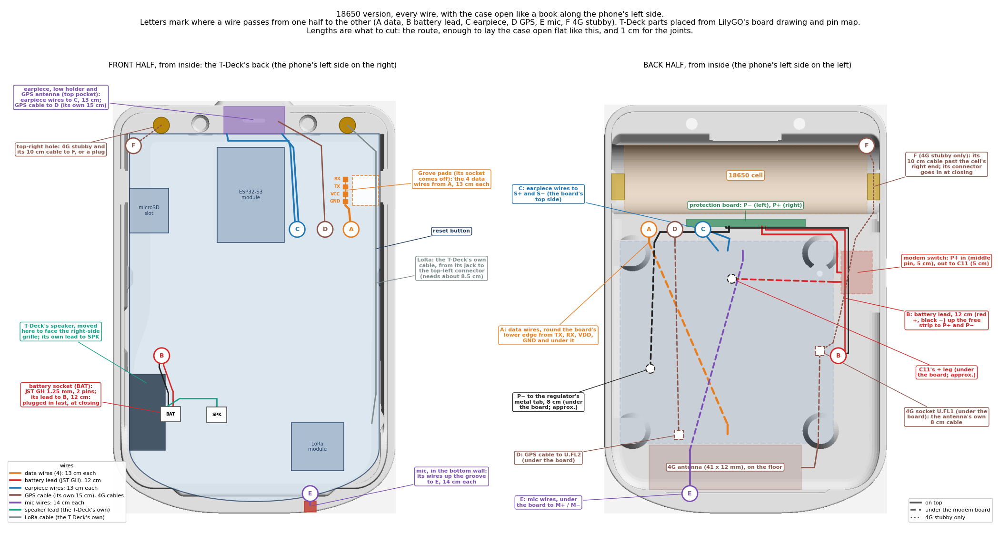
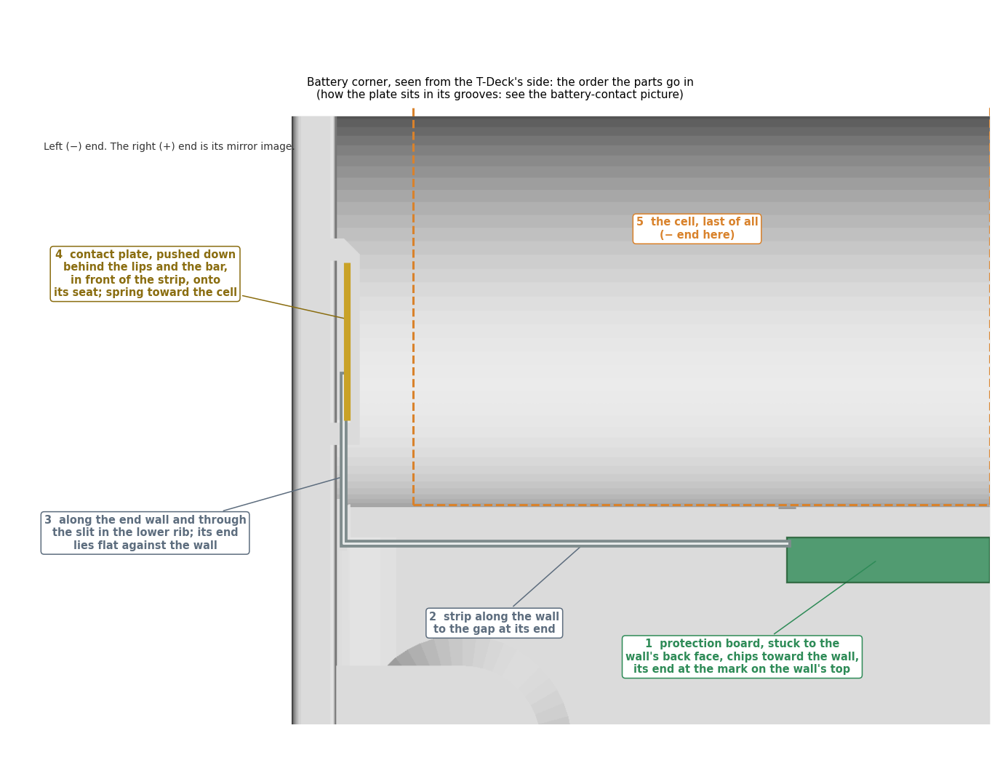
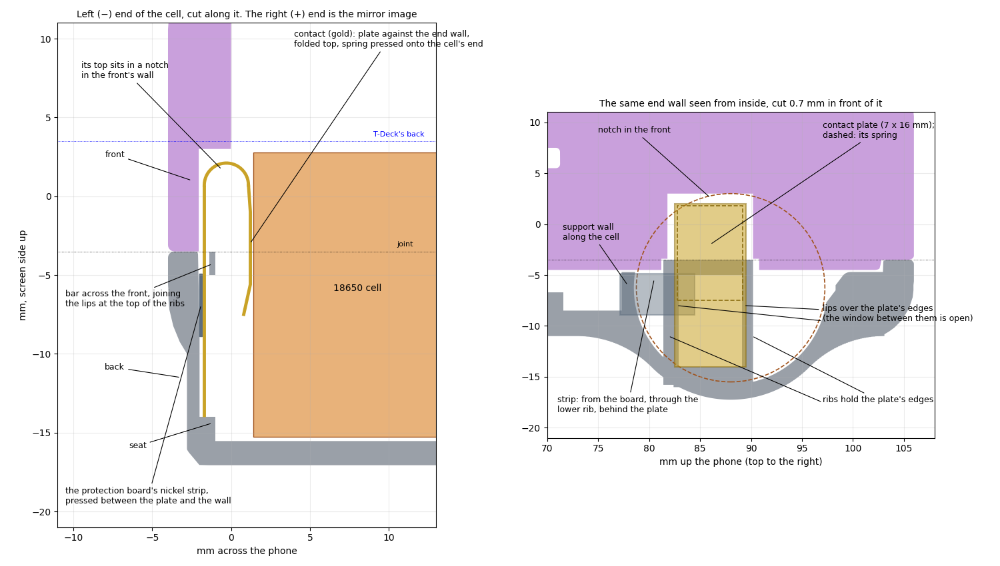
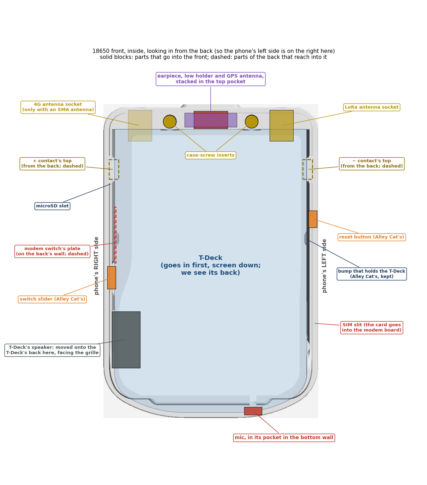
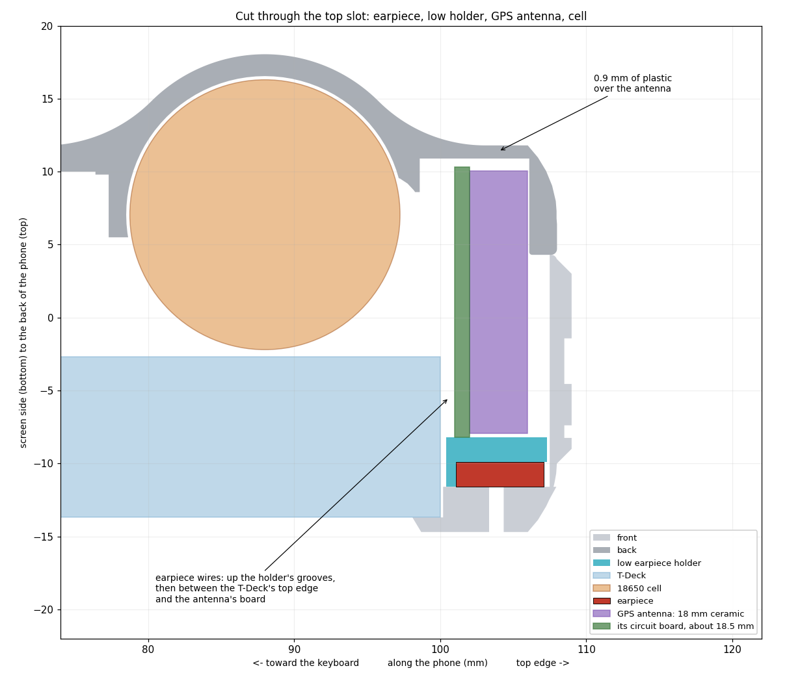

# Assembly: 18650 version

How the 18650 version goes together. The design itself is in [design-18650.md](design-18650.md), every wire in
[the wiring picture](images/wiring-18650.png), and the current build's assembly in [assembly.md](assembly.md).

**Status (13 Nov 2026): a draft, written from the 3D model before the first print.** Check it against the real parts
at the dry fit (list at the end) and expect small changes.

## The pictures

**Where each part sits in the back:**

**Every wire, with the case open like a book** along the phone's left side: the front half (with the T-Deck's back)
on the left, the back half on the right. Letters mark where a wire passes from one half to the other. Dashed: under
the modem board. The T-Deck's parts are placed from LilyGO's own board drawing and pin map. The routes are a guide:
settle them at the dry fit.

**The battery corner, in the order the parts go in:**

**How a contact plate sits in its grooves:**

**Wire lengths to cut** (also on the picture): the route, plus enough to lay the case open flat along its left side
as in the picture, plus 1 cm for the joints. The wires that pass between the halves (A, C, D, E) do so near the
left side, the book's spine, so they need little extra.

| Wire | From → to | Cut to |
|---|---|---|
| Data wires (4) | T-Deck's Grove pads → KTRON TX, RX, VDD, GND (A) | 13 cm each |
| Earpiece wires (2) | earpiece → KTRON S+, S− (C), the 47 µF capacitors near the board end | 13 cm each |
| Mic wires (2) | mic → KTRON M+, M− (E) | 14 cm each |
| Battery lead (JST GH 1.25 mm, 2 wires) | T-Deck's BAT socket → protection board P+, P− (B) | 12 cm |
| P+ → switch, middle pin | 24 AWG | 5 cm |
| Switch, outer pin → C11's + leg | 24 AWG | 5 cm |
| P− → regulator's metal tab | 24 AWG | 8 cm |
| GPS cable | antenna → U.FL2 (D) | its own 15 cm; about 11 cm is used |
| 4G antenna cable (inside antenna) | antenna → U.FL1 | its own 8 cm; about 4 cm is used |
| 4G stubby cable (if used) | top-right hole → U.FL1 (F) | the KTRON 10 cm IPX → SMA cable; about 7.5 cm is used |

**Two that cross on the right side,** far from the spine, can't reach across the open case:
- **the battery lead** is plugged into the T-Deck last, just before closing (step 9);
- **the 4G stubby's cable** stays plugged into U.FL1, and its SMA end goes into the front's top-right hole as the
  halves close.

To open the case again later, unplug the battery lead first.

**What goes into the front:**

## Before you start

- **Printed parts,** all in [case/18650/stl/](../case/18650/stl/), in ASA, at 100 % in the slicer:
  - the back, the front and the low earpiece holder;
  - Alley Cat's slider for the T-Deck's switch and her reset button;
  - an antenna plug for each top hole that stays empty (the GSM plug for the top-right hole if the 4G antenna is
    inside).
- **Fasteners:**
  - 6 × M3 heat-set inserts (4.5 mm hole, 5 mm long): 2 for the front, 4 for the back's standoffs.
  - 2 × M3 × 8 cap (socket-head) screws to close the case, as in the current build. Their 5.5 mm heads sit in the
    back's two recesses.
  - 4 × M3 × 6 screws with **low heads** (pan or button head, no more than about 2.5 mm tall) for the modem board.
    There's only 3.1 mm between the board and the T-Deck, so tall cap screws won't fit.
  - 2 × M2 × 8 countersunk screws and 2 × M2 nuts for the modem switch.
- **Electronics:**
  - the modem board, past its bench tests, with its two flat capacitors glued down, the mic on its yellow (+) and
    green (−) wires, and the 1 kΩ resistor on the SIM-card side;
  - the T-Deck;
  - the LG MJ1 cell, the two contacts from the holder, and the protection board;
  - the SS-12F15 modem switch;
  - a JST GH 1.25 mm 2-pin lead for the T-Deck's battery socket (the type is on LilyGO's pin map);
  - the earpiece, with its two 47 µF capacitors already on its wires;
  - the GPS antenna (Eteily), the 4G antenna (the 41 × 12 mm one inside, or the stubby) and the LoRa stubby.
- **Also:** 24 AWG wire for the battery wires, thin wire, heat-shrink, double-sided tape, hot glue, a multimeter, side
  cutters and a small file.

## Steps

### 1. Clean up the prints

1. Take the supports out of the back: under the standoffs, in the cell's channel and under the support wall.
2. Check the cell drops into its channel without force. It has 0.25 mm all round.
3. Check the contact grooves and the strip slits are clear:
   - the plate should go down behind its lips with a firm push;
   - a nickel strip should pass through the thin slit in each lower rib.

   Scrape a tight groove lightly with a knife.
4. Clear the modem switch's slot and its two countersunk holes in the back's right wall.

### 2. Heat-set inserts

Set 2 inserts in the front's top screw holes and 4 in the back's standoffs. Press them in straight, and let them cool
before loading them.

### 3. Dry fit, and check the wire lengths

1. Set the modem board on its standoffs (no screws yet). Hold the protection board against the support wall between
   its two marks, and the switch in its slot. Lay the T-Deck in the front.
2. Lay a piece of string along each route in the wiring picture and check it against the length table. Adjust a
   length if the real route is longer.

### 4. Power wires, on the bench

These joints are made before the parts go in, because two of them end up under the modem board.

1. **Modem board:**
   - Take off the 5 V bench wires from VCC and the GND beside it. VCC isn't used again.
   - On the component side, solder a 24 AWG wire to C11's + leg (5 cm, it will go to the switch) and one to the
     regulator's metal tab (8 cm, it will go to P−).
   - Check with the meter: C11's + leg must **not** beep to VCC.
2. **Battery lead** (JST GH 1.25 mm, 12 cm):
   - First check which wire of the lead lands on the T-Deck socket's **+**. JST leads are sold wired both ways.
   - Solder its + wire to the protection board's P+ and its − wire to P−.
3. **Protection board:**
   - Solder a 5 cm 24 AWG wire from P+ for the switch.
   - Solder the regulator wire (8 cm) from the modem board to P−.
4. **Switch:**
   - P+ wire to the middle pin; the C11 wire to one outer pin. Leave the other outer pin free.
   - Sleeve every joint with heat-shrink.
5. **Check with the meter:**
   - P+ to P− must not beep.
   - Switch on: P+ beeps to C11's + leg. Switch off: it doesn't.
6. **Other wires** (they're already on the modem board from the bench tests):
   - Cut the four data wires to 13 cm each from the board.
   - Cut the earpiece wires to 13 cm each from the board, plug sockets off, keeping the 47 µF capacitors near the
     board end.
   - Check the mic wires are about 14 cm. Extend them if they're shorter; tuck any extra under the board.

   Their other ends get soldered later (steps 8 and 7).

### 5. Battery corner

Follow the battery-corner picture. The right (+) end is the mirror image of the left.

1. **Protection board:**
   - Stick it to the back face of the support wall with double-sided tape.
   - Chips toward the wall, P+ and P− facing the modem board, B− at the left end.
   - Its ends go at the two marks on the wall's top.
2. **Strips:**
   - Lead each strip along the wall to its end, through the gap there, and along the end wall.
   - Pass it through the slit in the contact's lower rib, so its end lies flat against the end wall behind the
     lips.
   - About 2 mm past the rib is enough. Trim any extra.
3. **Contacts:**
   - Cut each solder foot off at the bend with side cutters, and file the edge smooth. Don't bend it inward: there
     is no room.
   - Push each plate down behind the lips and the bar, in front of the strip, until it sits on its seat. Spring
     toward the cell, folded end up. It's a firm push.
   - **−** goes at the left end and **+** at the right, as engraved on the floor.
4. **Check with the meter:** each plate beeps to the pad at its end of the protection board (B− at the left, B+ at the
   right).

Leave the cell out until step 9.

### 6. Modem switch, 4G antenna and modem board

1. **Modem switch:**
   - Plate on the pad inside the back's right wall, knob out through the slot.
   - 2 × M2 × 8 countersunk screws from outside, nuts inside.
   - It should slide end to end, its knob standing out about 0.1 mm.
2. **4G antenna, the inside one:**
   - Lay it on the floor along the bottom, between the two lower standoffs, cable end on the right.
   - Its lower edge goes into the curve where the floor meets the bottom wall.
   - Hold it with a strip of tape, keeping its backing on, until it passes the signal test
     ([design-18650.md](design-18650.md#4g-antenna)).
   - (With the stubby instead, its cable comes in from the front's top-right hole: step 7.)
3. **Antenna cables into the board's underside,** before the board goes down:
   - the 4G cable into U.FL1, 3.6 mm in from the board's right edge;
   - the GPS cable into U.FL2, near its lower edge.

   If the GPS antenna hasn't arrived, leave U.FL2 free. Adding it later means taking the board out again.
4. **Wires under the board** (the wiring picture):
   - the data wires: round the board's lower edge, out at its top-left corner (A);
   - the GPS cable: in at the top-left corner (D) to U.FL2;
   - the mic wires: in at the bottom (E), out at the board's top edge to M+ and M−;
   - the battery wires from C11 and the regulator's tab: out toward the switch and the protection board.

   The battery lead to the T-Deck runs up the free strip on the right (B), not under the board.
5. **Modem board:** component side down, SIM holder toward the left wall. Screw it down with the 4 low-head
   M3 × 6 screws.

### 7. Front half

1. **Alley Cat's parts:** the slider for the T-Deck's switch (right side) and the reset button (left side).
2. **Mic:**
   - Turn it so its two pins sit side by side, level with each other and parallel to the screen.
   - Push it into its pocket in the bottom wall from inside, until it touches the skin, and glue it.
   - Bend its wires up into the groove and through the notch in the lip.
   - **This must happen before the T-Deck goes in.**
3. **Earpiece:**
   - Fold its two spring contacts flat over its back, and solder the earpiece wires to them.
   - Keep the joints small: the holder's roof leaves only 0.2 mm for solder.
   - Lay it in the top pocket, gasket side down over the slot, one long side against the pocket's far wall.
   - Put each wire into the groove at its end of the low holder, then push the holder down onto the pocket floor.

   
4. **GPS antenna:**
   - Stand it on its edge on the holder's roof and the steps beside it, ceramic toward the phone's top edge.
   - Turn it so its amplifier is at the end toward the back cover.
   - A dab of hot glue at its foot holds it. Its cable goes down past the cell's left end to U.FL2.
5. **Antenna connectors:**
   - **Top-left:** the T-Deck's own LoRa cable. From inside, push the SMA thread out through the hole, so its hex
     collar sits in the hex pocket. Fit the lock washer and nut outside.
   - **Top-right:** with the 4G stubby, its IPX → SMA cable stays plugged into U.FL1 in the back. Its SMA end goes
     into this hole as the halves close (step 9). With the inside antenna, the hole gets the GSM antenna plug after
     closing.
6. **Speaker:** fix the T-Deck's speaker on the T-Deck's back with double-sided tape, near its right edge, so it
   faces the new grille on the right side (15–36 mm up). It stays on its own lead to the T-Deck's SPK socket.

### 8. T-Deck

1. **Data wires:**
   - Desolder the Grove socket. It's on the T-Deck's back near its left edge, about 15 mm below its top edge.
   - Solder the four wires: Grove TX to KTRON TX, RX to RX, VCC (the switched 3.3 V) to VDD, GND to GND.
     Straight across, not crossed (tested on the bench).
   - Sleeve the joints ([wiring.md](wiring.md), section 1).
2. **Into the front:**
   - Switch the T-Deck off.
   - Lower it into the front, screen down, its switch lined up with the slider.
   - Check the mic wires stay in their groove.

### 9. Cell in, and close

1. **Both switches off:** the T-Deck's and the modem's.
2. **Wires:** with the halves open side by side, lay the wires along their routes (the wiring picture).
   - On the T-Deck's back: the data wires from A to the Grove pads, and the earpiece wires (C) and GPS cable (D)
     down the left of its ESP32 module. Lay them flat on its board, between its parts, never over them: the cell
     sits only 0.5 mm under the T-Deck's tallest parts.
   - The battery lead runs up the free strip on the right (B). It isn't plugged in yet.
   - Nothing lies across the 4G antenna. Wires may cross above it.
3. **Cell:**
   - **+ end to the right** (the modem switch's side), as engraved on the floor.
   - Press it straight down into the channel. The contacts' folded tops guide it in.
4. **Check with the meter:**
   - Modem switch off: C11's + leg reads about 0 V.
   - Modem switch on: it reads the cell's voltage, 3.6–4.2 V. Then switch it off again.
5. **Close:**
   - Bring the back over the front, a few cm apart, and plug the battery lead into the T-Deck's battery socket
     (BAT): low on its back near its right edge, beside the speaker's socket (SPK).
   - With the 4G stubby: hold its SMA connector in the front's top-right hole, hex collar in its pocket.
   - Fold the back onto the front. The tops of the two contacts go into the notches in the front's side walls.
   - Check that no wire is caught where the halves meet.
   - Press until the lip snaps in, then fit the 2 × M3 × 8 screws through the back's recesses into the front's
     inserts.

### 10. Finish

1. **SIM:**
   - Modem off. Push a micro-SIM into the slit on the front's left side, in its finger scoop, until it clicks.
   - Which way: follow the card picture beside the slit.
   - Push again to release it. The modem only reads the SIM when it starts.
2. **microSD (if used):** into the slot on the right side, following the picture beside it.
3. **Antennas:**
   - the LoRa stubby on the top-left connector;
   - the 4G stubby on the top-right one, if used: first its lock washer and nut, in the round recess;
   - otherwise the printed plug in each empty hole.
4. **Power:**
   - The T-Deck's switch is the slider on the right side. The modem's is on the back's right wall, just below the
     grip.
   - Once the modem is on, the network light shows through the back's window. It stays lit steadily while it
     searches, and blinks quickly once it's registered.
   - Switch both off together. A modem left on drains the cell in about a week.
5. **Signal test** for the inside 4G antenna ([design-18650.md](design-18650.md#4g-antenna)). It needs the T-Deck's
   first program, which passes modem commands from the Mac. Until then, the network light shows whether the modem
   registers.

## Things to check at the first dry fit

- **Cell:** drops into its channel and lies flat; the case closes over it.
- **Contacts:**
  - each plate holds in its grooves;
  - the strips reach behind the plates (about 28 mm needed, about 29.5 mm available);
  - their tops go into the front's notches.
- **Modem board:** the SIM holder, the screw heads, the wire joints and the mic resistor all clear the T-Deck. There's
  3.1 mm above the board.
- **Modem switch:** slides end to end. The M2 × 8 screws are long enough, and the knob stands out about 0.1 mm.
- **Top pocket:** with the earpiece, the low holder and the GPS antenna in, the case closes with no rattle. Check
  the antenna's real board fits the 19.5 mm slot.
- **Wires on the T-Deck's back:** flat between its parts. With the case closed, none presses on the cell.
- **LoRa cable:** its tail in the top-left corner lies flat above the cell's left end.
- **Speaker:** faces the grille. The T-Deck's switch slider and the reset button both work.
- **Stubby only:** the 10 cm IPX → SMA cable reaches the top-right hole past the cell's right end (it needs about
  9 cm).
- **Network light:** visible through the back's window.
