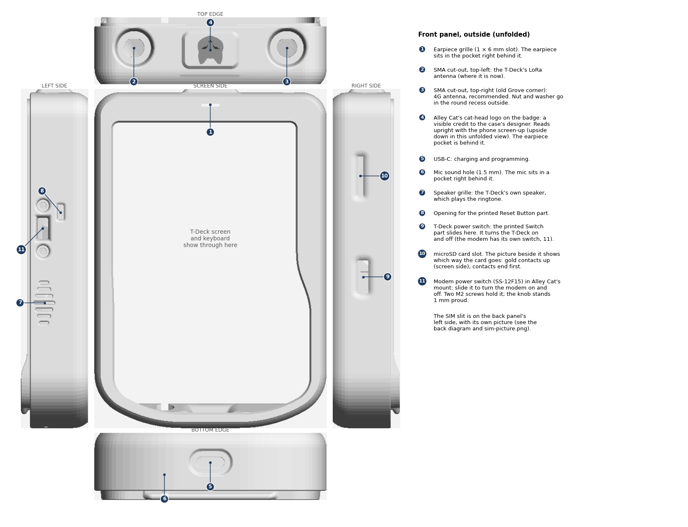
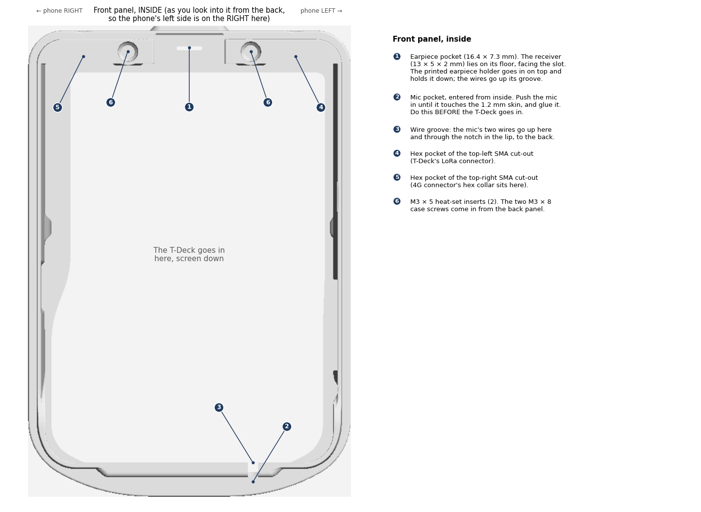
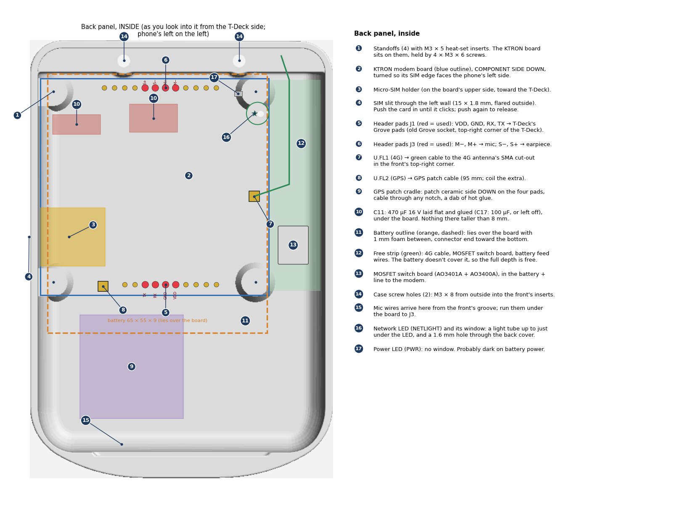
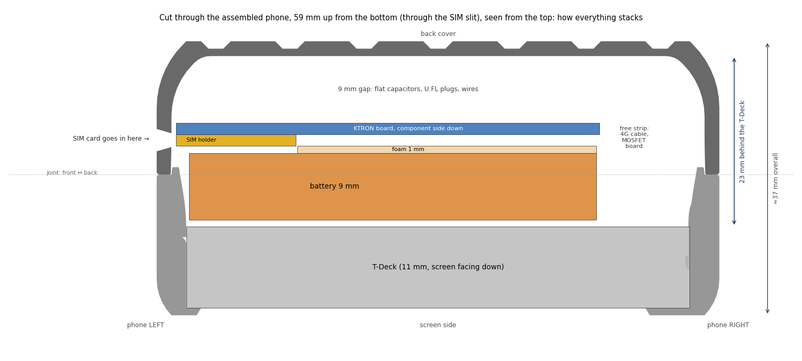

# Assembly

How everything goes into the case. The numbers in the steps refer to the callouts in the pictures. The pictures
are drawn from the actual case files ([case/scripts/make_diagrams.py](../case/scripts/make_diagrams.py)).

This is the plan before the first dry fit. Expect small changes after it.

## The pictures

**Front panel, outside:** every opening and what it's for. The four edges are unfolded around the screen side.

**Front panel, inside:** earpiece and mic pockets, antenna hex pockets, screw inserts.

**Back panel, inside:** where the modem board, SIM, GPS patch, capacitors, battery and cables go.

**Cut through the assembled phone:** how the layers stack, from the screen to the back cover.

## Before you start

- **Printed parts:** [front](../case/front-earpiece-mic.stl), [back](../case/back-modem-gps.stl),
  [earpiece holder](../case/earpiece-holder.stl), and the original Switch and Reset Button parts from Printables.
- **Fasteners:**
  - 6 × M3 × 5 heat-set inserts: 2 for the front, 4 for the back.
  - 2 × M3 × 8 screws for closing the case.
  - 4 × M3 × 6 screws for the modem board.
- **The modem board is past its bench tests:**
  - phase B is done ([bring-up.md](bring-up.md));
  - the 5 V bench wires are removed;
  - the two tall capacitors are swapped for flat ones and glued (back ⑩);
  - nothing on its component side stands more than 8 mm high.
- **The T-Deck's Grove socket is desoldered.**

## Steps

### 1. Inserts

Heat-set the 2 inserts into the front's top holes (front inside ⑥), and the 4 inserts into the back's standoffs
(back ①). Press them in straight, and let them cool before loading them.

### 2. Wires

Solder these before anything goes into the case. Leave every wire a little long, because the two halves open
like a book while you work.

| From | To | Wire |
|---|---|---|
| T-Deck Grove pads: TX, RX, 3.3 V, GND | KTRON J1: RX, TX, VDD, GND (back ⑤, red pads) | thin, about 10 cm. TX goes to RX, RX to TX |
| Earpiece (Micromax receiver) | KTRON J3: S+, S− (back ⑥) | thin, either way round |
| Mic | KTRON J3: M+, M− (back ⑥). The pin connected to the mic's can goes to M− | thin, about 12 cm (from the bottom of the phone) |
| Battery +, through the MOSFET board | KTRON C11 + pad or MIC29302 pin 4 | 24 AWG, short |
| Battery − | KTRON GND (regulator tab) | 24 AWG, short |
| KTRON VDD pad (Grove 3.3 V) and GND | MOSFET board (gate wire and ground) | thin |

Details and checks are in [wiring.md](wiring.md).

### 3. Front panel

1. **Earpiece** (front inside ①):
   - Solder its two wires first.
   - Lay the receiver in the pocket, gasket side down, centred over the slot.
   - Lead the wires up the earpiece holder's groove, then push the holder down over the receiver until it sits on
     the pocket floor. The groove faces the T-Deck side.
   - When the case is shut, the back's solid block between its two screw holes (back ⑭) closes over the holder,
     so it can't lift.
2. **Mic** (front inside ②): push it into its pocket from inside until it touches the skin, and glue it. Lay its
   two wires in the groove (③) and through the notch in the lip. **This must happen before the T-Deck goes in.**
3. **Antenna connectors** (front outside ② and ③):
   - From inside, push the SMA thread out through the hole, so the hex collar sits in the hex pocket (front inside
     ④ and ⑤).
   - Outside, put on the lock washer and nut in the round recess, and tighten.
   - Top-left is the T-Deck's own LoRa connector. Top-right is the 4G cable (recommended).
4. **Printed Switch and Reset Button parts**: fit them into their openings (front outside ⑨ and ⑧).
5. **T-Deck**: lower it in, screen down. Its power switch must line up with the Switch part on the right side.
   Check the mic wires stay in their groove.

### 4. Back panel

1. **GPS patch** (back ⑨): ceramic side **down** onto the four pads. Lead its cable out through the notch nearest
   the modem's GPS socket. Fix it with a dab of hot glue at two corners.
2. **Plug in the antenna cables before the board goes down.** The U.FL sockets are on the board's underside.
   - GPS cable to U.FL2 (back ⑧). Coil the spare cable loosely in the gap under the board.
   - 4G cable to U.FL1 (back ⑦), running out into the free strip on the right (⑫), toward the top-right corner.
3. **Modem board** (back ②): component side **down**, with the SIM edge toward the phone's left wall (the SIM slit,
   ④). Screw it to the standoffs with 4 × M3 × 6.
4. **MOSFET board** (⑬): in the free strip, in the battery + line.
5. **Foam**: lay a 1 mm foam sheet over the board, with a cut-out for the SIM holder (③).
6. **Battery** (⑪): lay it on the foam over the board, connector end toward the bottom of the phone. Plug its JST
   lead into the T-Deck's battery socket.

### 5. Close

1. Fold the back onto the front. Check that no wire is caught where the halves meet: the mic wires pass through
   the notch in the front's lip.
2. Press until the lip snaps in, then fit the 2 × M3 × 8 screws through the back's top holes (back ⑭) into the
   front's inserts.

### 6. Finish

1. **SIM**: push a micro-SIM into the slit on the back's left side until it clicks. A fresh multi-cut SIM, popped
   out at micro size, works better than a nano in an adapter. Push again to release it.
2. **Antennas**: screw the LoRa antenna onto the top-left connector, and the 4G antenna (700–2700 MHz) onto the
   top-right one.
3. **Power**: switch on with the T-Deck's own power switch. The modem comes on with it.

## Things to check at the first dry fit

- **4G connector clearance:** the connector's tail clears the T-Deck in the old Grove corner (3–8 mm past the
  T-Deck's top edge).
- **SIM:** the card lines up with the slit and clicks into the holder.
- **Battery:** it sits flat over the board with about 1 mm to spare under the T-Deck.
- **Mic:** it fits its pocket. Print the mic test coupon first.
- **Earpiece:** the receiver fits the holder's 13.4 × 5.4 mm cup. With the holder in, there's no rattle and the case
  still closes fully.
