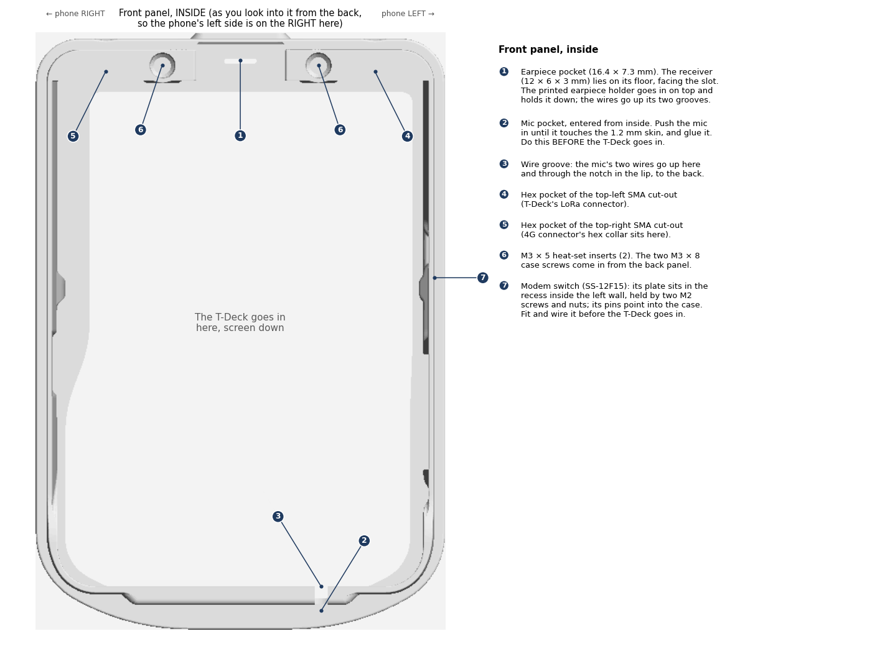
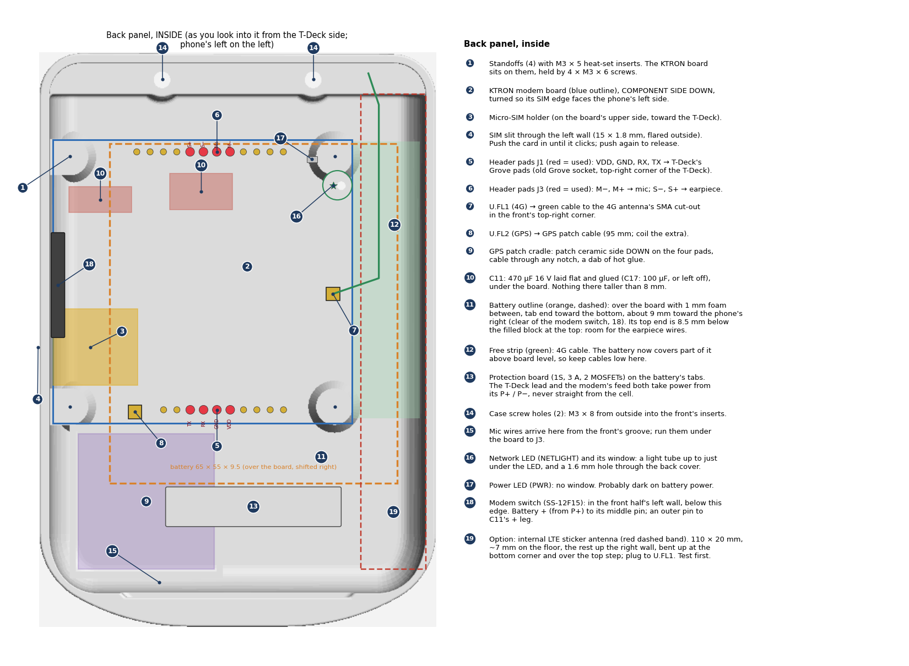
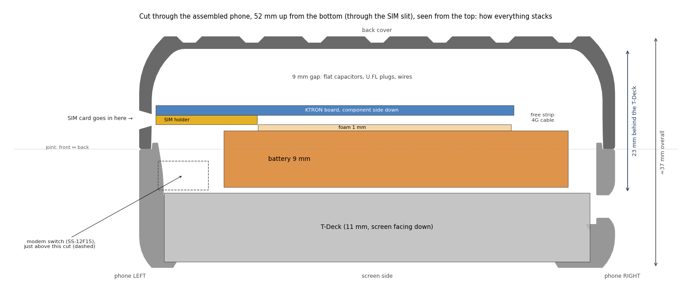
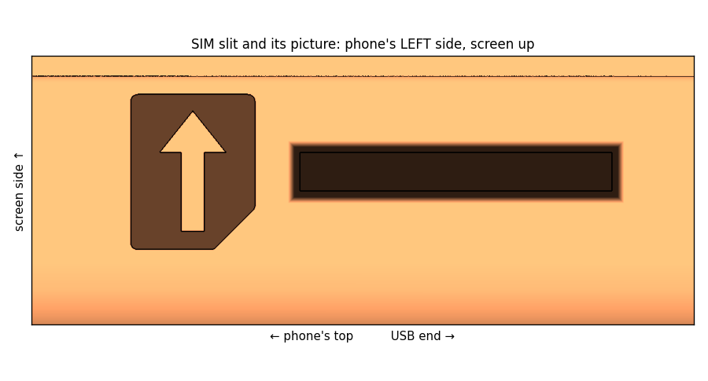
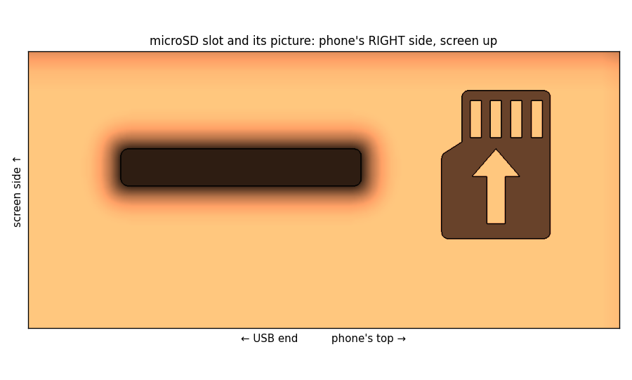

# Assembly

How everything goes into the case. The numbers in the steps refer to the callouts in the pictures. The pictures
are drawn from the actual case files ([case/scripts/make_diagrams.py](../case/scripts/make_diagrams.py)).

This is the plan before the first dry fit. Expect small changes after it.

> **18650 version:** these steps are for the current build. The 18650 version's assembly steps will be written once
> its print files are built. Until then, see [design-18650.md](design-18650.md).

## The pictures

**Front panel, outside:** every opening and what it's for. The four edges are unfolded around the screen side.

**Front panel, inside:** earpiece and mic pockets, antenna hex pockets, screw inserts.

**Back panel, inside:** where the modem board, SIM, GPS patch, capacitors, battery and cables go.

**Cut through the assembled phone:** how the layers stack, from the screen to the back cover.

## Before you start

- **Printed parts:** all in [case/x-back-5000mah/stl/](../case/x-back-5000mah/stl/), already built 1 % larger (print them at 100 % in the slicer): the [front](../case/x-back-5000mah/stl/front-earpiece-mic.stl), the
  [back](../case/x-back-5000mah/stl/back-modem-gps.stl), the [earpiece holder](../case/x-back-5000mah/stl/earpiece-holder.stl), and Alley Cat's
  [Switch](../case/x-back-5000mah/stl/alley-chat-td1-switch.stl) and [Reset Button](../case/x-back-5000mah/stl/alley-chat-td1-reset-button.stl).
- **Fasteners:**
  - 6 × M3 × 5 heat-set inserts: 2 for the front, 4 for the back.
  - 2 × M3 × 8 screws for closing the case.
  - 4 × M3 × 6 screws for the modem board.
  - 2 × M2 countersunk screws (6–8 mm) and 2 × M2 nuts for the modem switch.
- **Bought and owned parts:** the SS-12F15 modem switch (4 mm knob), and the 1S 3 A protection board soldered on the
  battery's tabs.
- **The modem board is past its bench tests:**
  - phase B is done ([bring-up.md](bring-up.md));
  - the 5 V bench wires are removed;
  - the two tall capacitors are swapped for flat ones and glued (back ⑩);
  - nothing on its component side stands more than 8 mm high.
- **The T-Deck's Grove socket is desoldered.**

## Steps

### 1. Inserts

Heat-set the 2 inserts into the front's top holes (front inside ⑥), and the 4 inserts into the back's standoffs
(back ①). Press them in straight, and let them cool before loading them.

### 2. Wires

Solder these before anything goes into the case. Leave every wire a little long, because the two halves open
like a book while you work.

| From | To | Wire |
|---|---|---|
| T-Deck Grove pads: TX, RX, 3.3 V, GND | KTRON J1: TX, RX, VDD, GND (back ⑤, red pads) | thin, about 12 cm: from the KTRON's holes, under the board to the free strip (⑫), then up the strip to the old Grove corner. TX goes to TX, RX to RX (straight across, tested on the bench) |
| Earpiece (Micromax receiver) | KTRON J3: S+, S− (back ⑥), through a 47 µF capacitor in each wire (+ leg to the board) | thin, about 12 cm, either way round |
| Mic | KTRON J3: M+, M− (back ⑥). The pin connected to the mic's can goes to M−. **Also a 1 kΩ resistor from M− to ground**, on the SIM-card side, lying flat ([wiring.md](wiring.md), section 4) | thin, about 18 cm: it runs from the bottom of the phone to the top of the board, and the case must still open. Tuck spare wire under the board |
| Protection board P+ | Modem switch, middle pin (front, left wall) | 24 AWG |
| Modem switch, one outer pin | KTRON C11's + leg (470 µF) | 24 AWG. With the wire above, about 15 cm in total |
| Protection board P− | KTRON GND (regulator tab) | 24 AWG, short |
| Protection board P+ / P− | T-Deck battery socket, through the cell's JST lead | as it is |

Details and checks are in [wiring.md](wiring.md).

### 3. Front panel

1. **Earpiece** (front inside ①):
   - Fold its two spring contacts flat over its back, and solder a thin wire to each. Keep the joints small.
   - Lay the receiver in the pocket, gasket side down, over the slot, with one long side against the pocket's far
     wall (the outer wall of the case).
   - Put each wire into the groove at its end of the holder. Then push the holder down over the receiver until it
     sits on the pocket floor. The grooves face the T-Deck side.
   - When the case is shut, the back's solid block between its two screw holes (back ⑭) closes over the holder,
     so it can't lift.
2. **Mic** (front inside ②):
   - Trim its pins to about 1.5 mm and solder a thin wire to each. The pin in the insulating ring is **+** (to M+).
     The pin joined to the metal can is **−** (to M−).
   - Turn it so the two pins sit side by side, level with each other and parallel to the screen. Push it into its
     pocket from inside until it touches the skin, and glue it.
   - Bend both wires up into the groove (③) and through the notch in the lip.
   - **This must happen before the T-Deck goes in.**
3. **Antenna connectors** (front outside ② and ③):
   - From inside, push the SMA thread out through the hole, so the hex collar sits in the hex pocket (front inside
     ④ and ⑤).
   - Outside, put on the lock washer and nut in the round recess, and tighten.
   - Top-left is the T-Deck's own LoRa connector. Top-right is the 4G cable (recommended).
4. **Modem switch** (front outside ⑪, front inside ⑦): put the SS-12F15 in from inside, with the plate in the recess
   and the knob through the slot. Fix it with 2 × M2 countersunk screws from outside and nuts inside. Its pins point
   into the case. Solder its two wires (middle pin and one outer pin) now, and lead them toward the back half along
   the left wall.
5. **Printed Switch and Reset Button parts**: fit them into their openings (front outside ⑨ and ⑧).
6. **T-Deck**: lower it in, screen down. Its power switch must line up with the Switch part on the right side.
   Check the mic wires stay in their groove and the modem switch's wires aren't trapped under it.

### 4. Back panel

1. **GPS patch** (back ⑨): ceramic side **down** onto the four pads. Lead its cable out through the notch nearest
   the modem's GPS socket. Fix it with a dab of hot glue at two corners.
2. **Plug in the antenna cables before the board goes down.** The U.FL sockets are on the board's underside.
   - GPS cable to U.FL2 (back ⑧). Coil the spare cable loosely in the gap under the board.
   - 4G cable to U.FL1 (back ⑦), running out into the free strip on the right (⑫), toward the top-right corner.
   - **Or the internal LTE sticker** (back ⑲): press its U.FL plug onto U.FL1 and lay the strip along the right side,
     about 7 mm on the floor and the rest up the wall, bending up at the bottom corner and over the top step. Tape it
     until the signal test says it's good enough ([wiring.md](wiring.md), section 6).
3. **Modem board** (back ②): component side **down**, with the SIM edge toward the phone's left wall (the SIM slit,
   ④). Screw it to the standoffs with 4 × M3 × 6.
4. **Protection board** (⑬): already on the battery's tabs, at its bottom end, insulated with tape.
5. **Foam**: lay a 1 mm foam sheet over the board, with a cut-out for the SIM holder (③).
6. **Battery** (⑪): lay it on the foam over the board, tab end toward the bottom of the phone, about 9 mm toward the
   phone's right, with its top end level with the board's top edge (just below the J3 pads). That keeps it clear of
   the modem switch (back ⑱) and leaves about 8.5 mm at the top for the earpiece wires. Plug its JST lead into the
   T-Deck's battery socket.

### 5. Close

1. Fold the back onto the front. Check that no wire is caught where the halves meet: the mic wires pass through
   the notch in the front's lip.
2. Press until the lip snaps in, then fit the 2 × M3 × 8 screws through the back's top holes (back ⑭) into the
   front's inserts.

### 6. Finish

1. **SIM**: push a micro-SIM into the slit on the back's left side until it clicks. A fresh multi-cut SIM, popped
   out at micro size, works better than a nano in an adapter. Push again to release it.
   - **Which way:** follow the picture engraved beside the slit, with the phone screen-up:
     - the gold contacts face down;
     - the **cut corner goes in last**, toward the phone's USB end.

     End-to-end, it still clicks in but isn't read (`SIM REMOVED`).

     
   - Insert it with the modem off, or restart the modem afterwards: it only reads the SIM at start-up.
2. **microSD (if used)**: follow the picture beside the slot on the phone's right side. With the phone screen-up,
   the gold contacts face up and the contacts end goes in first.

   
3. **Antennas**: screw the LoRa antenna onto the top-left connector, and the 4G antenna (700–2700 MHz) onto the
   top-right one. With the internal LTE sticker, push the printed antenna plug into the top-right hole instead.
4. **Power**: switch on the T-Deck with its own switch (right side) and the modem with its switch (left side).
   Switch both off together, because a modem left on drains the battery in about 10 days.

## Things to check at the first dry fit

- **4G connector clearance:** the connector's tail clears the T-Deck in the old Grove corner (3–8 mm past the
  T-Deck's top edge).
- **SIM:** the card lines up with the slit and clicks into the holder.
- **Battery:** it sits flat over the board with about 1 mm to spare under the T-Deck.
- **Earpiece wires:** they pass between the battery's top end and the back's solid block between the case screws.
  Since the 7 Nov 2026 layout change there's about 8.5 mm there.
- **Mic:** it fits its pocket. Print the mic test coupon first.
- **Internal LTE sticker:** compare its signal inside the case with its signal in the open before sticking it down
  ([bring-up.md](bring-up.md), "Checking the sticker antenna inside the case").
- **Modem switch:** it slides freely end to end, and the T-Deck sits flat under it (0.5 mm clearance by design). Its
  pins and wires stay clear of the battery's left edge.
- **Earpiece:** the receiver fits the holder's 12.4 mm cup, between the holder's wall and the pocket's far wall. With the holder in, there's no rattle and the case
  still closes fully.
