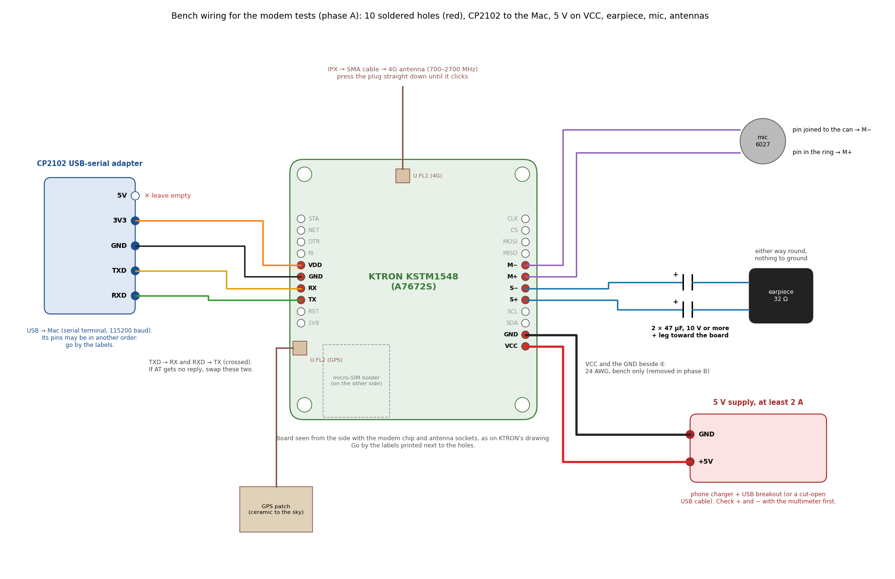

# Bring-up

## Bench checks when the parts arrive

The KTRON board arrives **without pin headers**: its holes are empty. So the bench tests need a few wires soldered
in. They are the same wires the finished phone uses, so nothing is wasted.

- **Phase A, bench tests.** Solder wires into only the 10 holes the phone needs. Power the board from a 5 V supply
  on VCC and test it from the Mac, inside the return window.
- **Phase B, after deciding to keep the board.** Remove the VCC wire and move the modem to battery power, as in the
  finished phone.

The phone firmware doesn't exist yet, so the **Mac talks to the modem through the CP2102 USB-serial adapter** (owned,
3.3 V pin). It uses the same four KTRON holes the T-Deck will use later. The CP2102's signals are 3.3 V, the same as
the T-Deck's, so there are no settings to change.

### What you need for phase A

- Soldering iron, solder, thin wire (24 AWG for the two power wires)
- KTRON board, CP2102 adapter, and 10 female-to-female jumper wires, 20 cm long: one for each hole. Don't cut them in
  half, because half a jumper is too short for the phone. Cut one plug off and solder that end into the KTRON. The
  other plug goes onto the CP2102 or the 5 V supply. For the earpiece and mic, cut off both plugs.
- **5 V supply, at least 2 A:** a phone charger with a USB breakout board or a cut-open USB cable. KTRON's page gives
  the VCC input as 5–12 V DC. Use 5 V, because the board's regulator then runs coolest. Do **not** use the CP2102's
  5V pin: a Mac USB port can't reliably supply the modem's current bursts.
- LTE antenna (700–2700 MHz) and the IPX → SMA cable
- GPS patch antenna
- SIM: a fresh Jio SIM, or Airtel/Vi (see the SIM warning below). The holder takes **micro-SIM**.
- Multimeter
- Earpiece (the Micromax receiver) and a Sunrom mic
- **2 × 47 µF electrolytic capacitors, 10 V or more,** about 4–5 mm across, plus heat-shrink tubing. One goes in
  each earpiece wire (see the table). A 100 µF one works too.

If something hasn't arrived yet, skip the step that needs it and come back to it. But don't run the network steps
without the LTE antenna.

**When the LTE antenna matters:**
- **No SIM in:** the modem only listens for the network and never transmits. So all the no-SIM checks are safe with
  just the IPX → SMA cable, or even nothing, on U.FL1.
- **With a SIM:** it transmits to register and to make calls, up to 2 W in 2G bursts. SIMCom asks for an antenna that
  wastes little of that, and an open cable end reflects most of it back into the modem. Signal would also be weak, so
  registration or VoLTE could fail and make a good board look faulty. Fit a real 4G antenna before inserting the
  SIM: SMA **male** (with a centre pin), rated 700–2700 MHz.
- **Avoid Wi-Fi router antennas:** most are RP-SMA (no centre pin, so they won't connect) and tuned only for
  2.4 GHz.
- **U.FL sockets wear out:** they're made for only about 30 plug-ins. Plug the cable into U.FL1 once and leave it
  there.

### Phase A: the 10 holes to solder



```
left row:   STA  NET  DTR  RI  [VDD] [GND] [RX] [TX]  RST  1V8
right row:  CLK  CS  MOSI  MISO  [M-] [M+] [S-] [S+]  SCL  SDA  [GND] [VCC]
```

Solder only the holes in brackets, and leave the rest empty.

| KTRON hole | Wire goes to | Notes |
|---|---|---|
| TX (left) | CP2102 TXD | **Straight across, not crossed** (tested: the modem doesn't answer when they're crossed). Leave the four data wires long. They move to the T-Deck's Grove pins later |
| RX (left) | CP2102 RXD | The modem's replies arrive on this wire |
| VDD (left) | CP2102 3V3 | Sets the signal level to 3.3 V. Draws only microamps |
| GND (left) | CP2102 GND | |
| — | CP2102 5V | **Leave unconnected** |
| VCC (right) | 5 V supply + | **Bench only**, removed in phase B. Check the supply's polarity with the multimeter first |
| GND (right) | 5 V supply − | Bench only, removed in phase B |
| S+ and S− | Earpiece, through a **47 µF capacitor in each wire** | Each capacitor's **+ leg goes to the board** (the + leg is the longer one; the − side has a stripe). The earpiece itself goes either way round. Nothing goes to ground. This is the final wiring, so it can be soldered in for good (see below) |
| M+ and M− | Mic (Sunrom 6027) | The pin in the insulating ring → M+. The pin joined to the metal can → M−. Check with the multimeter's continuity mode: the − pin beeps to the can |
| U.FL1 (top edge) | LTE antenna cable | Press straight down until it clicks |
| U.FL2 (beside L2) | GPS patch | |

**Earpiece capacitors:** SIMCom's and KTRON's reference circuits both put a 47 µF capacitor in series with each
earpiece wire, so that no steady current can flow through the earpiece's coil. Solder each capacitor straight onto
its earpiece wire, + leg toward the KTRON, and cover the joints with heat-shrink. In the phone they lie flat in the
gap under the board.

**Wire lengths** (so the same wires do for the finished phone):

| Wires | Length |
|---|---|
| VDD, GND, RX, TX (to the CP2102 now, to the T-Deck later) | a whole jumper with one plug cut off, about 18 cm. When moving them to the T-Deck, cut off the other plug and trim to about 12 cm |
| Earpiece (S+, S−) | about 12 cm |
| Mic (M+, M−) | about 18 cm. Spare wire tucks into the gap under the board |
| VCC and the GND beside it (bench only) | any |

**Soldering tips:**

- Strip about 2 mm, and twist and tin the wire.
- **Push it in from the side with the antenna sockets.** Solder on the other side and trim what sticks out. In the
  phone, the wires then leave into the 9 mm gap under the board. The soldered side faces the battery, with only about
  1.5 mm to spare.
- The holes are 2.54 mm apart and the wanted ones sit side by side. Watch for solder bridges between neighbours.
- Keep the iron on each joint only for a couple of seconds.

There is **no battery in phase A**. VCC is the board's normal input. The "never feed VCC" rule only applies once the
cell is connected in phase B.

KTRON's warranty doesn't cover short-circuited boards, so check every joint before switching on.

### Phase A steps

0. **Look first.** Check the board for damage. Confirm it has **two** u.FL antenna sockets: U.FL1 at the top edge
   (LTE), and U.FL2 beside inductor L2 (GNSS). KTRON's product page only mentions one. Look up KTRON's return policy
   and note the last day. A board with soldered wires may not be accepted back, so check that too.
1. **Solder the 10 wires** as in the table. Then check, with the multimeter in continuity mode, between VCC and the
   GND next to it. A short beep that stops is just the capacitors charging. A steady beep means a solder bridge: fix
   it before going on. Look closely at every joint for bridges to the neighbouring holes.
2. **Power and serial, no SIM yet.** Connect the CP2102 and the 5 V supply. The power LED should light. If it
   doesn't, unplug at once and recheck the polarity. Open the serial terminal (see below), wait about 20 seconds for
   the modem to start, then type `AT`. You should get `OK`. If nothing comes back, check that the wires go straight
   across (TX to TXD, RX to RXD). Then check that VDD is on 3V3, and that the terminal is set to 115200 baud with a carriage return. Type `ATI` and
   **write down the firmware build**. It matters if the Jio problem shows up.

   **Before the SIM arrives: earpiece, mic and GPS.** These need no SIM. If a command answers `ERROR`, this
   firmware doesn't have it: skip it, and that part gets tested with the first call instead.
   - **Earpiece:** send `AT+CSDVC=1` (sound to the earpiece), then `AT+SIMTONE=1,1000,200,200,3000`. You should
     hear 3 seconds of beeps. Other ways: `AT+CLDTMF=2,"1,2,3"` plays keypad tones, and `AT+CTTS=2,"hello"` speaks.
   - **Mic:** send `AT+CREC=1,"c:/t.amr"`, talk at the mic for a few seconds, and send `AT+CREC=0`. Then
     `AT+CCMXPLAY="c:/t.amr",0,0` plays it back on the earpiece. **A silent result doesn't prove a fault.** On this
     firmware the mic got no power during a recording (see the results below), so the first real call is the real test.
   - **GPS:** step 6 works without a SIM.

3. **SIM and network.** Unplug the 5 V. Put the SIM in the holder on the back of the board. Make sure the LTE
   antenna is connected. Power on and wait about 30 seconds. Then send `AT+CFUN?`. If it answers `4`, the radio is off
   (flight mode), so send `AT+CFUN=1`. This board was in flight mode when tested without a SIM, even with its blue
   LED on.

   | Command | Good answer |
   |---|---|
   | `AT+CPIN?` | `+CPIN: READY` (SIM found) |
   | `AT+CSQ` | First number 10–31 is usable signal. `99` = no signal |
   | `AT+CEREG?` | Second number `1` (home) or `5` (roaming) = registered on 4G. `2` = still searching. `3` = refused (on a Jio SIM this is the known problem: try an Airtel/Vi SIM) |
   | `AT+COPS?` | Operator name |
   | `AT+CPSI?` | Shows LTE and the band |
   | `AT*IMSRCFG="switch"` | `"switch","on"` (VoLTE path on) |

   The network LED also changes its blink pattern once the modem is registered.
4. **Call.** With the earpiece and mic connected, send `AT+CSDVC=1`, `AT+COUTGAIN=4`, `AT+CMICGAIN=4` and
   `AT+CLIP=1`.
   - Call your other phone with `ATD+91XXXXXXXXXX;` and answer it. The modem prints `VOICE CALL: BEGIN`.
   - During the call, send `AT+CPSI?`. `LTE` means **VoLTE works**. `GSM` means it fell back to 2G.
   - Listen on the earpiece and talk into the mic. Change the earpiece volume with `AT+COUTGAIN` (0–7) a step at a
     time. If the other side hears you faintly, raise `AT+CMICGAIN` (0–7) a step at a time.
   - Hang up with `AT+CHUP`.
   - Then call the module from your phone. `RING` and `+CLIP: "<number>"` appear. Answer with `ATA`.
5. **SMS (receive).** Send `AT+CMGF=1` and `AT+CNMI=2,1,0,0,0`. Send an SMS to the module from your phone.
   `+CMTI:` appears with a number at the end. `AT+CMGR=<that number>` shows the message. (Sending an SMS from the
   module needs Ctrl-Z to finish the message, which works in Terminal's `screen` but not in the Arduino Serial
   Monitor.)
6. **GNSS.** Take the patch outdoors with the ceramic side facing the sky, and send `AT+CGNSSPWR=1`. Wait for
   `+CGNSSPWR: READY!`, because `AT+CGNSSINFO` answers `ERROR` until then. If it hasn't appeared after a minute, send
   `AT+CGNSSPWR=0`, then `AT+CGNSSPWR=1` again. Then send `AT+CGNSSINFO` every minute or so. Empty commas = no fix yet. Latitude and longitude = fix. The first fix can take
   a few minutes. If there is still no fix after about 15 minutes outdoors, check the antenna power: the centre pin
   of U.FL2 should read about 1.8–3.3 V DC. Probe it carefully, because a slipped probe shorts it.
7. **Decide.** If everything passed, keep the board and go to phase B. If something failed, contact KTRON before
   the return deadline. If only Jio fails but Airtel/Vi works, that is the known Jio problem. Decide whether you can
   live with Airtel/Vi until SIMCom fixes it.

### Bench results so far (5 Nov 2026, no SIM, no antenna, 5 V on VCC)

| Check | Result |
|---|---|
| `AT` | `OK`, once TX and RX went straight across |
| `ATI` | A7672S-FASE, firmware **A7672M7_V1.11.1** (`AT+CSUB`: B07V04) |
| `AT+CFUN?` | `4` (flight mode) at every power-up tested without a SIM. `AT+CFUN=1` worked and stayed on until power-off |
| `AT+CSQ` | 20 with the radio on and only the SMA cable fitted, so it hears towers |
| `AT+CPIN?` | `SIM not inserted`, as expected |
| `AT+CPMUTEMP` | 28 °C |
| `AT+CBC` | About 0.01 V, which can't be right for a running modem. Measure the real voltage with the multimeter |
| Earpiece | Works. Tones (`AT+SIMTONE`), speech (`AT+CTTS`) and file playback (`AT+CCMXPLAY`) were all heard. `AT+COUTGAIN=7` was set after it sounded low, and survives a restart |
| Mic | **Not proven yet.** Recordings held no voice (peak 7 of 32768, mostly 50 Hz hum). M+ to M− read 0 V during a recording, though VDD read 3.3 V with the same meter. No short between M+ and M− (no steady beep). So the modem seems not to power the mic when recording outside a call. Test it on the first real call |

### Phase B: after deciding to keep the board

1. Unplug the 5 V supply. Desolder the two bench power wires (VCC and the GND beside it). From now on the **VCC
   hole is never used again**.
2. **Swap the two tall capacitors.** The stock ones are 11 mm tall SMD cans, too tall for the board to fit under the
   9 mm battery. Before removing each one, note which pad is +.
   - **C11** (330 µF 50 V, next to the modem chip): replace it with the **470 µF 16 V** radial capacitor, laid flat
     (about 7 mm high). Solder its leads flat onto the old pads.
   - **C17** (100 µF 50 V, next to the regulator): replace it with the **100 µF 16 V**, laid flat. If its + pad
     beeps to the VCC pin, you can leave it off instead, because VCC isn't used on battery power.
   - **Glue both bodies to the board** with hot glue or silicone, so they can't lever the pads off.
   - Lay them on bare board or small resistors and capacitors, **not** on the modem chip or the regulator.
     Nothing on that side may stand more than 8 mm off the board, because the back's standoffs are 9 mm.
3. **Battery pad check** with the multimeter: the pad you will feed must show continuity to the + pad of C11, and
   **not** to VCC. Then connect the cell (through the modem power switch, if it's built) as in
   [wiring.md](wiring.md), section 2.
4. Repeat `AT` → `OK` and one test call, now on battery power.
5. **LEDs:**
   - **Power LED (PWR):** check it on battery power. If it's dark, it's on the unused VCC input and draws nothing,
     so leave it. If it lights, it's on the battery rail and draws about 2 mA all the time. Remove its resistor R6
     (1 kΩ, just below it).
   - **Network LED (NETLIGHT):** once registered it is lit half the time (200 ms on / 200 ms off) through R1
     (220 Ω, beside it). That's roughly 2–4 mA on average, depending on the LED's colour, and the AT commands
     can't switch it off. To save power but keep it visible through the back's window, replace R1 with a 1 kΩ
     0805, which uses about a fifth of the current. Or remove R1 to turn it off completely.

### Serial terminal on the Mac

- **Arduino IDE Serial Monitor:** pick the adapter's port, set **115200 baud**, set line ending to
  **Carriage return** (or **Both NL & CR**). The modem ignores commands that don't end with a carriage return.
- **Or Terminal:** `ls /dev/cu.*` shows the adapter's name. Then `screen /dev/cu.<name> 115200`. To quit, press
  Ctrl-A, then K, then Y.
- If the Mac doesn't list the adapter at all, install Silicon Labs' CP210x USB-to-UART driver.

### SIM warning

KTRON's own note and an open LilyGO GitHub issue
([#231](https://github.com/Xinyuan-LilyGO/LilyGo-Modem-Series/issues/231)) both report the same problem. A
**Jio SIM that has ever been used in a 5G phone** may not register on the A7672S ("PLMN not allowed"). A SIMCom fix
is pending. Test with a fresh Jio SIM or an Airtel/Vi SIM.

There is no audio loopback command on SIMCom modules (`AT+QAUDLOOP` is Quectel's). But the earpiece and mic can be
checked without a SIM by playing a tone and recording yourself (step 2). A real call is still the final test.

## T-Deck side (firmware)

```
GPIO10 HIGH (PWR_EN) + gpio_hold_en(10)    Grove 3.3 V stays on in light sleep
UART0 115200 8N1 on GPIO43 (TX) / GPIO44 (RX)
```

Sleep: the modem sleeps with `AT+CSCLK=2`, and any byte sent to it wakes it. The ESP32-S3 goes into light sleep
and wakes on serial data on GPIO44, so an incoming `RING` / `+CLIP:` wakes the phone.

## Modem commands

| Command | What it does |
|---|---|
| `ATI` | Shows the modem firmware build |
| `AT+CFUN=1` | Radio on (leaves flight mode). Not saved, so it's needed after each power-on if the board starts in flight mode |
| `AT+CPMVT=1,3300,4300` | Clean power-off below 3.3 V. **Check `AT+CBC` on battery first:** on the bench it read about 0.01 V, and this command acts on the modem's own voltage reading |
| `AT+CSCLK=2` | Modem sleeps; any byte wakes it |
| `AT+CSDVC=1` | Call audio to the earpiece pins (S+/S−) |
| `AT+COUTGAIN=4` | Earpiece volume, 0–7 (4 is the default) |
| `AT+CMICGAIN=4` | Mic gain, 0–7 (4 is the default). Raise it if the other person hears you faintly |
| `AT+CGNSSPWR=1` | GNSS on. Then `AT+CGNSSINFO` for a position, or `AT+CGNSSINFO=10` for repeated reports |
| `AT+CLIP=1` | Caller number shown with each `RING` |
| `AT+CMGF=1` | SMS in text mode |
| `AT+CNMI=2,1,0,0,0` | Tell the T-Deck when a new SMS arrives. `AT+CMGS` sends, `AT+CMGR` reads |
| `AT*IMSRCFG="switch"` | Expect `"switch","on"`: the VoLTE path is on |
| `ATD+91XXXXXXXXXX;` | Dial (the `;` makes it a voice call) |
| `ATA` | Answer |
| `AT+CHUP` | Hang up |
| `AT+CPSI?` | During a call: `LTE` = VoLTE, `GSM` = 2G fallback |

Other audio commands: `AT+CMUT` (mute the mic). No-SIM sound checks: `AT+SIMTONE` (tone), `AT+CLDTMF` (keypad
tones), `AT+CTTS` (speech), `AT+CREC` / `AT+CCMXPLAY` (record and play back). Some firmware builds don't have all
of them. `AT+CLVL` isn't in SIMCom's A76XX manual, so use `AT+COUTGAIN` for volume.

Messages the modem sends by itself: `RING`, `+CLIP:` (caller number), `VOICE CALL: BEGIN`, `VOICE CALL: END`.

**Never send `AT+BTPOWER=1`.** The module's built-in Bluetooth stays off.

### Spare Tracx-1b (Quectel EC200U) equivalents

GNSS: `AT+QGPS`, `AT+QGPSLOC=2`. Audio: `AT+CLVL`, `AT+QAUDMOD=2`.

## Manuals

- A76XX AT Command Manual V1.12:
  https://eicut.com/wp-content/uploads/2025/10/A76XX_Series_AT_Command_Manual_V1.12.pdf
- A7672S Hardware Design V1.00:
  https://www.ktron.in/wp-content/uploads/2023/03/A7672S_Hardware_Design_V1.00-1.pdf
