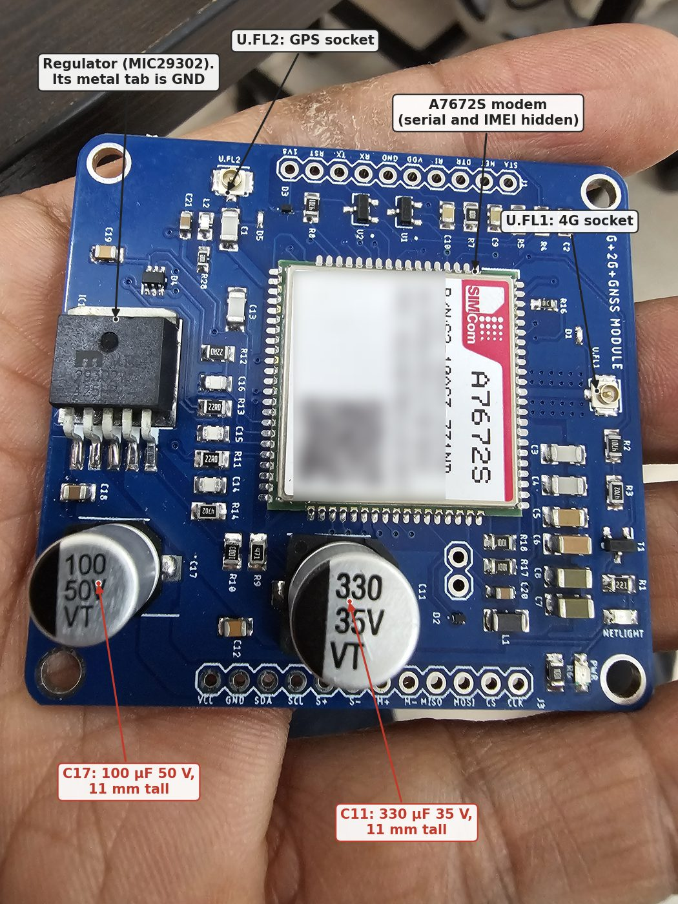
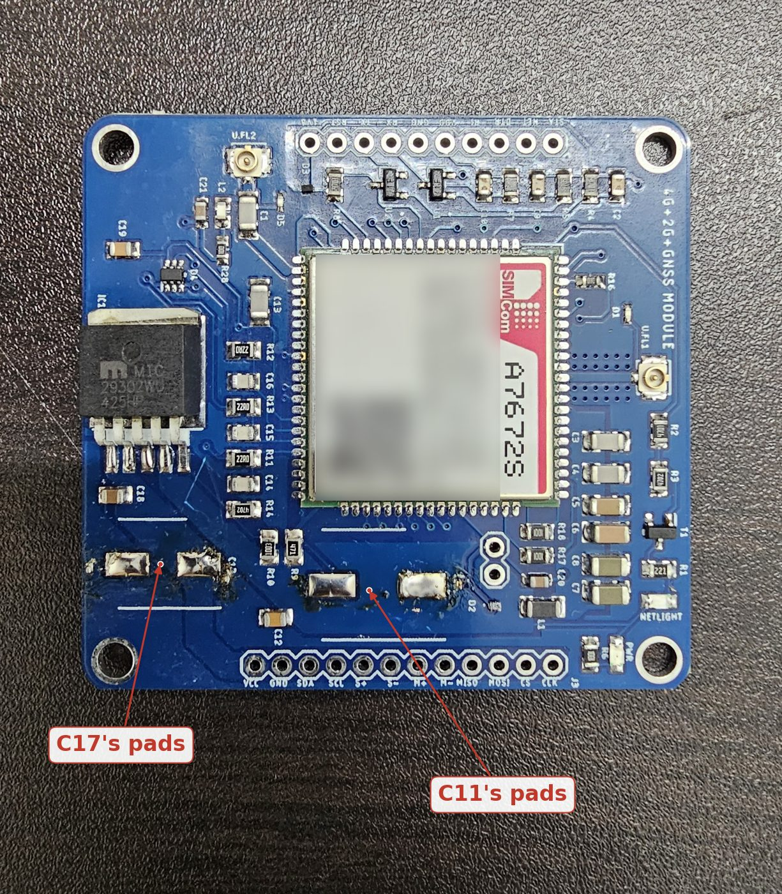
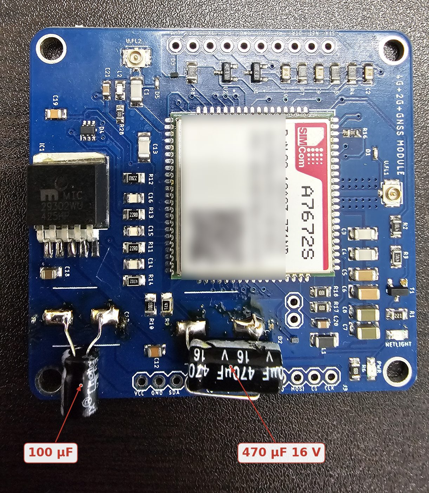
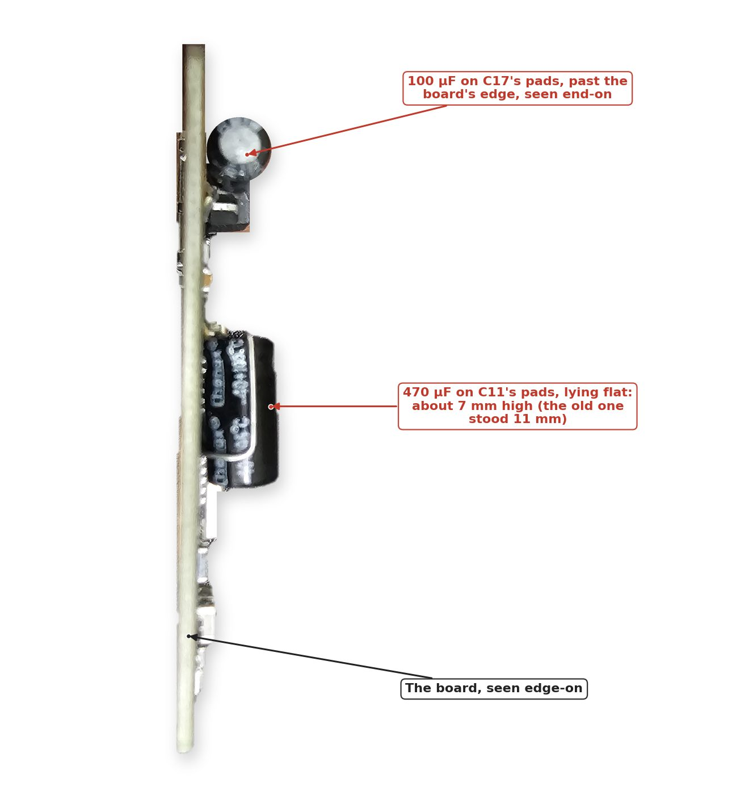
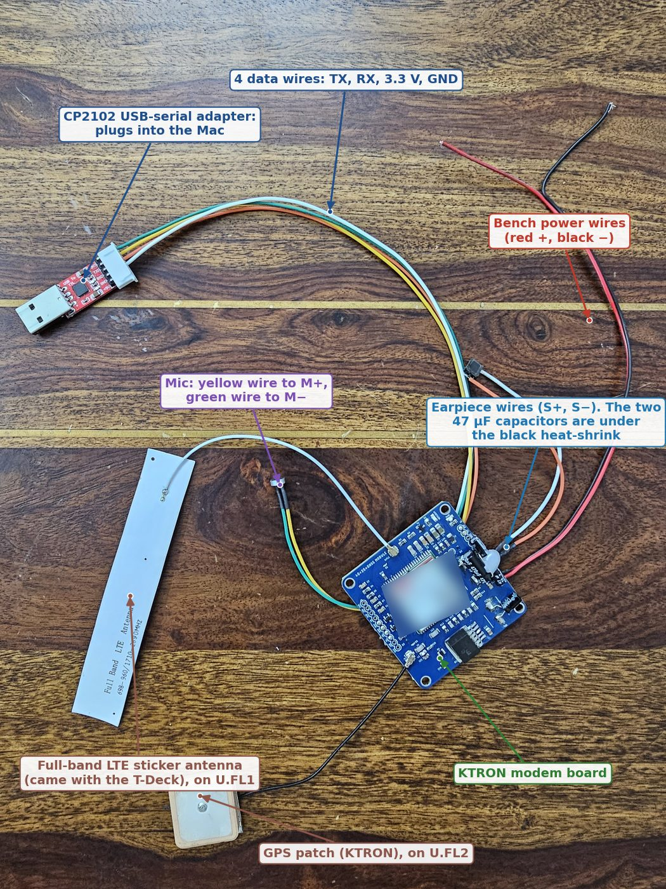
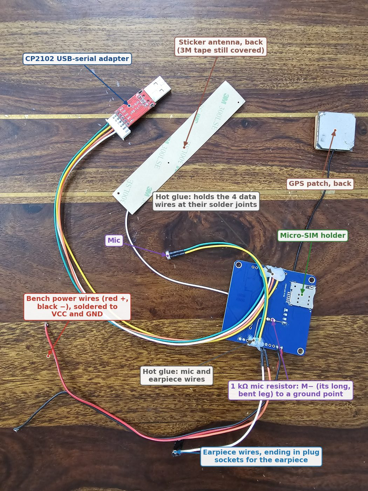
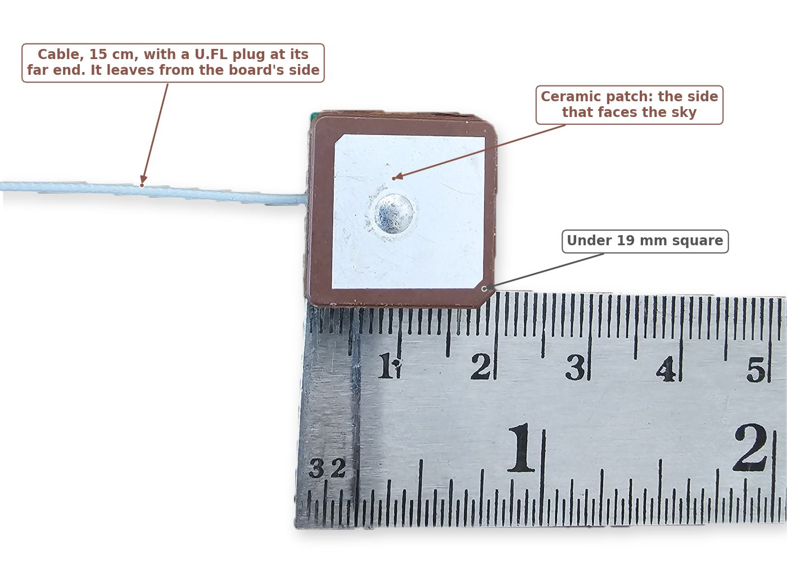
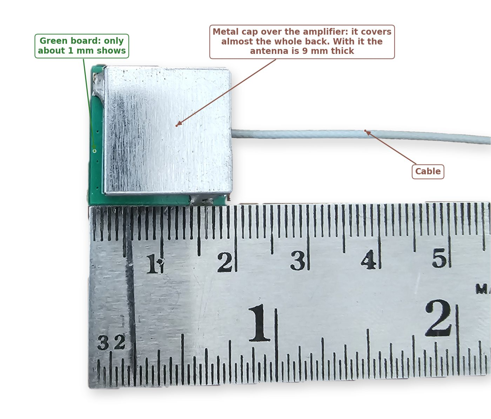
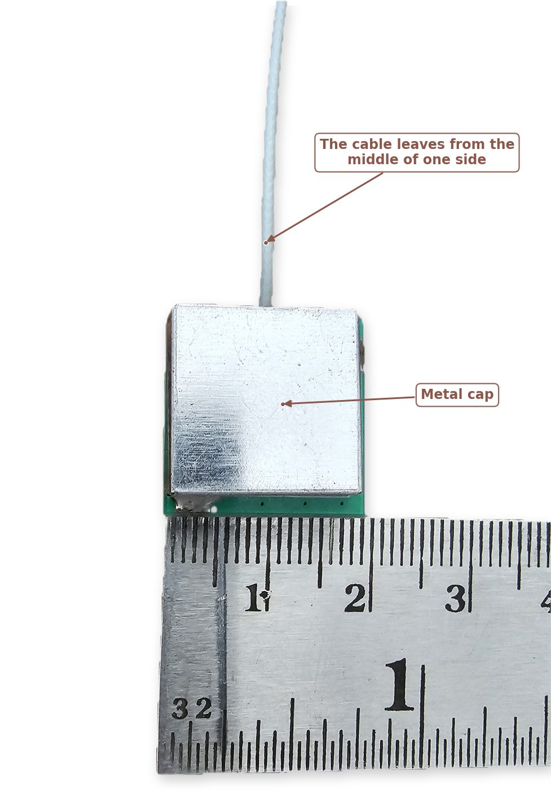

# Build log

The hardware as it was really built, step by step, with photos. The other docs explain the design and the reasons
for it. This page shows what was done and what it looked like. The newest step is at the bottom.

Each photo is shown on a white background, with its parts labelled. Before it goes in, its hidden data (location,
date, camera) is removed, and the modem's serial number, IMEI and QR code are blurred: the IMEI is the modem's
identity on the mobile network. Its make and model (SIMCom A7672S) and part number stay readable (see
[Adding photos](#adding-photos)).

## 1. Modem board: the tall capacitors swapped (4 Nov 2026)

**Why:** the KTRON board came with two capacitors 11 mm tall, too tall for the case. In the current build the board
sits under the 9 mm battery, and in the 18650 version on 8 mm standoffs. Radial capacitors laid flat take about
7 mm ([decisions.md](decisions.md#ktrons-tall-capacitors-swapped-for-radial-ones-laid-flat-decided-3-nov-2026)).

**As it arrived:** C17 (100 µF 50 V) and C11 (330 µF 35 V), both 11 mm tall. The photo also shows parts named in the
other docs: the regulator, whose metal tab is the modem's GND point for the battery, and the two antenna sockets.

  
  

**Taken off, then replaced:** both old capacitors came off their pads (left). A 470 µF 16 V went on C11's pads and a
100 µF 16 V on C17's, each on bent legs, lying flat (right).

**Height:** about 7 mm instead of 11.

**Checked on 5 Nov 2026,** with 5 V on the bench: both capacitors are the right way round. C11's + leg reads 3.86 V
and C17's 4.97 V, so C17 is on the VCC input ([bring-up.md](bring-up.md#bench-results-so-far-5-nov-2026-no-sim-no-antenna-5-v-on-vcc)).

## 2. Bench tests of the modem (5–11 Nov 2026)

**Setup:** the modem board on its own, talking to the Mac through the CP2102 USB-serial adapter, powered from 5 V
on VCC. Wired as in [bring-up.md](bring-up.md#phase-a-the-10-holes-to-solder) and its
[bench wiring picture](images/bench-wiring.png). Photographed on 12 Nov 2026.

**What it proved** (details in [bring-up.md](bring-up.md#results-with-a-jio-sim-7-nov-2026-the-full-band-sticker-antenna-on-ufl1-in-the-open-5-v-on-vcc)):
- **5 Nov:** the modem answers, once TX and RX go straight across (not crossed). The earpiece plays sound, and GPS
  gets a fix through a window.
- **7 Nov,** with a Jio SIM: registers on 4G with VoLTE. Calls work both ways, and so do text messages.
- **11 Nov:** the mic works in a call, once the 1 kΩ resistor from M− to ground was added. The mic in the photos is
  the replacement, on new wires: yellow to M+ and green to M−.

## 3. GPS antenna: arrived and tested (15 Nov 2026)

**Why:** the 18650 version swaps the 25 mm KTRON patch for a smaller active antenna from Eteily
(ET-GPL12-5L15C-U-184), meant to stand on its edge in the case's top slot
([design-18650.md](design-18650.md#gps-antenna)). Eteily sent no drawing, so the slot was drawn from its listed
size.

  
  

**Measured:**
- **Width and height:** under 19 mm, so it fits the slot's 19.5 mm width.
- **Thickness: 9 mm.** A metal cap over its amplifier covers almost the whole back of the board (only about 1 mm of
  green shows along two edges). The slot was drawn for about 6 mm, so **it doesn't fit the top slot as drawn**: it
  needs about 3 mm more room. See [design-18650.md](design-18650.md#gps-antenna) for the ways being weighed.
- **Cable:** 15 cm, with a U.FL plug. It leaves from the middle of one side of the board, not from the back.

**Tested on the bench:** the modem board on its own, as in step 2 (5 V on VCC, the CP2102 to the Mac), with no SIM.
The antenna went on U.FL2 in place of the KTRON patch. The modem feeds it 3.0 V (`AT+CVAUXV?`). GPS was switched on
with `AT+CGNSSPWR=1`, and every 30 seconds the modem's raw satellite data (NMEA, `AT+CGNSSTST=1`) was read for a few
seconds: which satellites it hears, how strongly, and how many it uses.

**Signal strength** is in dB-Hz, higher is better: over 40 is strong, under 30 weak.

| Where, how | Position | Satellites used | Heard at 30 dB-Hz or more | Best four, average | HDOP (lower is better) |
|---|---|---|---|---|---|
| Sofa, away from the window, leaning | none in 7 minutes | — | 0–1 (of 2–4 heard) | 19–26 dB-Hz | — |
| At the window, lying flat, ceramic up | about 1 minute after GPS was ready, held for 15 minutes | 12–14 (7–11 in the first 4 minutes) | 5–12 | 35–39 dB-Hz | 1.0–3.8 |
| At the window, on its edge, ceramic toward the glass | held for 15 minutes | 15–17 | 5–9 | 36–41 dB-Hz | mostly 0.8–1.0 |

**Compared with the KTRON patch** at the same window on 5 Nov 2026 ([bring-up.md](bring-up.md#bench-results-so-far-5-nov-2026-no-sim-no-antenna-5-v-on-vcc)):

| | Satellites in the position | HDOP | First position |
|---|---|---|---|
| KTRON patch, 5 Nov | 33 (GPS 16, BeiDou 9, Galileo 8) | 1.47 | about 7 minutes |
| Eteily, 15 Nov, at the end of the on-edge run | 35 (GPS 17, BeiDou 8, Galileo 10) | 1.24 | about 1 minute (lying flat) |

**What it shows:**
- **The antenna works well,** about as well as the KTRON patch.
- **It works on its edge,** the way it would sit in the top slot. At a window most of the open sky is through the
  glass, so facing the glass was its best direction there. Outdoors, with the phone lying flat, on its edge would be
  somewhat weaker than facing straight up.
- **Away from a window, GPS hears almost nothing.** That's the room, not the antenna.
- **The first-position times can't be compared.** The modem had been searching from the sofa ten minutes earlier,
  which can give it a head start.

## 4. Next: wiring the T-Deck

Photos to come once the printed parts are ready: the four data wires soldered to the T-Deck's Grove pads.

## 5. Next: assembly in the printed case

Photos to come: the parts going into the printed 18650 back and front.

## Adding photos

1. Take the photos with your phone and leave them in Downloads.
2. Ask Claude to add the latest ones to this page, and say what each step was.
3. Each photo is then turned the right way up, lifted off its background with the Mac's own "lift subject"
   feature, put on white, shrunk, labelled, and saved without its hidden data (location, date, camera). The modem's
   serial number, IMEI and QR code are blurred. The labels and any hand-traced fixes for every photo are listed in
   [docs/scripts/make_build_log_photos.py](scripts/make_build_log_photos.py), so they can be changed and the photos
   made again.
4. **Photos that come out best:** the parts on a plain surface that contrasts with them (a white sheet of paper
   suits dark and coloured parts), lit evenly, with no hand in the frame. Thin black wires on a dark table are the
   hardest to lift cleanly.

**Keep out of the photos:** the SIM card's number, phone numbers on a screen, and anything that shows where you live.
