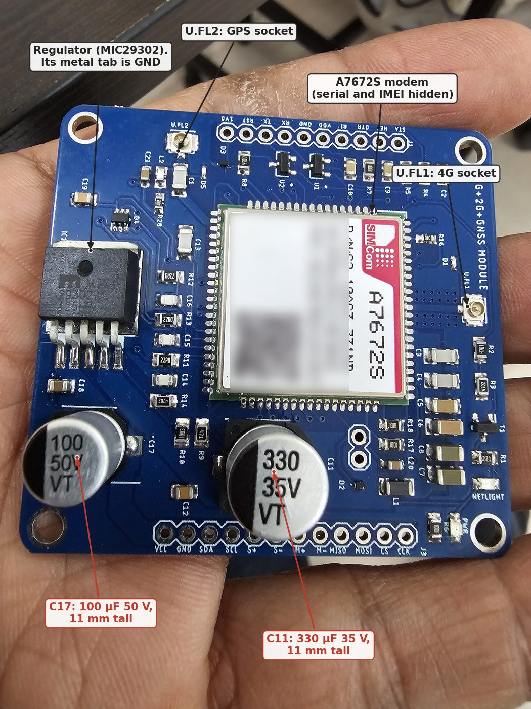
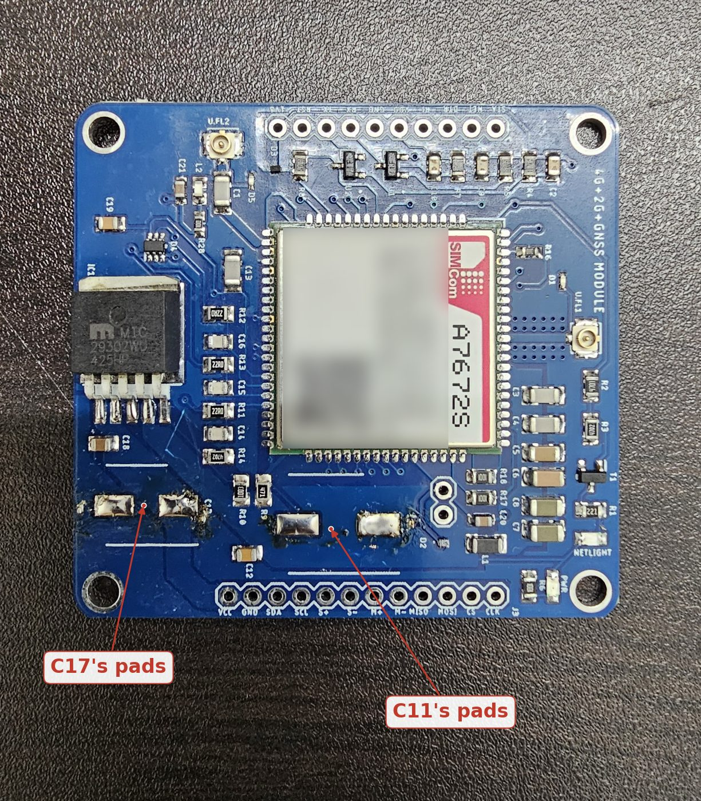
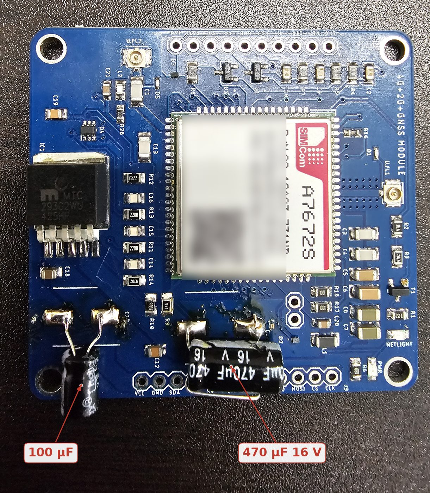
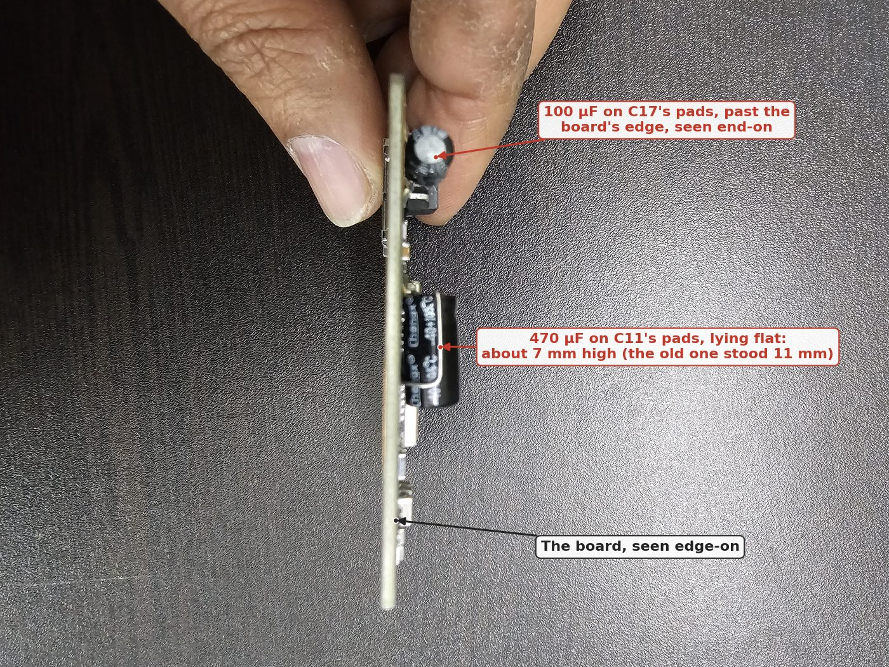
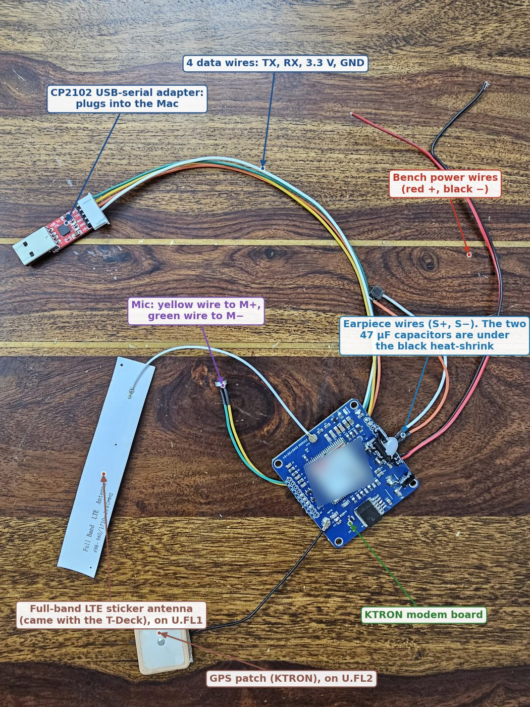
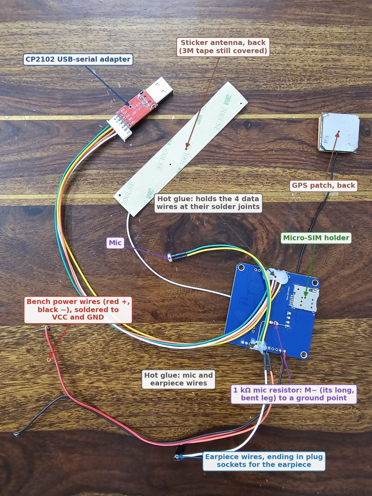

# Build log

The hardware as it was really built, step by step, with photos. The other docs explain the design and the reasons
for it. This page shows what was done and what it looked like. The newest step is at the bottom.

Before a photo goes in, its hidden data (location, date, camera) is removed and the modem's serial number and IMEI
are blurred (see [Adding photos](#adding-photos)).

## 1. Modem board: the tall capacitors swapped (4 Nov 2026)

**Why:** the KTRON board came with two capacitors 11 mm tall, too tall for the case. In the current build the board
sits under the 9 mm battery, and in the 18650 version on 8 mm standoffs. Radial capacitors laid flat take about
7 mm ([decisions.md](decisions.md#ktrons-tall-capacitors-swapped-for-radial-ones-laid-flat-decided-3-nov-2026)).

**As it arrived:** C17 (100 µF 50 V) and C11 (330 µF 35 V), both 11 mm tall. The photo also shows parts named in the
other docs: the regulator, whose metal tab is the modem's GND point for the battery, and the two antenna sockets.

  
  

**Taken off, then replaced:** both old capacitors came off their pads (left). A 470 µF 16 V went on C11's pads and a
100 µF 16 V on C17's, each on bent legs, lying flat (right).

**Height:** about 7 mm instead of 11.

**Checked on 5 Nov 2026,** with 5 V on the bench: both capacitors are the right way round. C11's + leg reads 3.86 V
and C17's 4.97 V, so C17 is on the VCC input ([bring-up.md](bring-up.md#bench-results-so-far-5-nov-2026-no-sim-no-antenna-5-v-on-vcc)).

## 2. Bench tests of the modem (5–11 Nov 2026)

**Setup:** the modem board on its own, talking to the Mac through the CP2102 USB-serial adapter, powered from 5 V
on VCC. Wired as in [bring-up.md](bring-up.md#phase-a-the-10-holes-to-solder) and its
[bench wiring picture](images/bench-wiring.png). Photographed on 12 Nov 2026.

**What it proved** (details in [bring-up.md](bring-up.md#results-with-a-jio-sim-7-nov-2026-the-full-band-sticker-antenna-on-ufl1-in-the-open-5-v-on-vcc)):
- **5 Nov:** the modem answers, once TX and RX go straight across (not crossed). The earpiece plays sound, and GPS
  gets a fix through a window.
- **7 Nov,** with a Jio SIM: registers on 4G with VoLTE. Calls work both ways, and so do text messages.
- **11 Nov:** the mic works in a call, once the 1 kΩ resistor from M− to ground was added. The mic in the photos is
  the replacement, on new wires: yellow to M+ and green to M−.

## 3. Next: wiring the T-Deck

Photos to come once the printed parts are ready: the four data wires soldered to the T-Deck's Grove pads.

## 4. Next: assembly in the printed case

Photos to come: the parts going into the printed 18650 back and front.

## Adding photos

1. Take the photos with your phone and leave them in Downloads.
2. Ask Claude to add the latest ones to this page, and say what each step was.
3. Each photo is then turned the right way up, shrunk, labelled, and saved without its hidden data (location, date,
   camera). The modem's serial number, IMEI and QR code are blurred. The labels for every photo are listed in
   [docs/scripts/make_build_log_photos.py](scripts/make_build_log_photos.py), so they can be changed and the photos
   made again.

**Keep out of the photos:** the SIM card's number, phone numbers on a screen, and anything that shows where you live.
