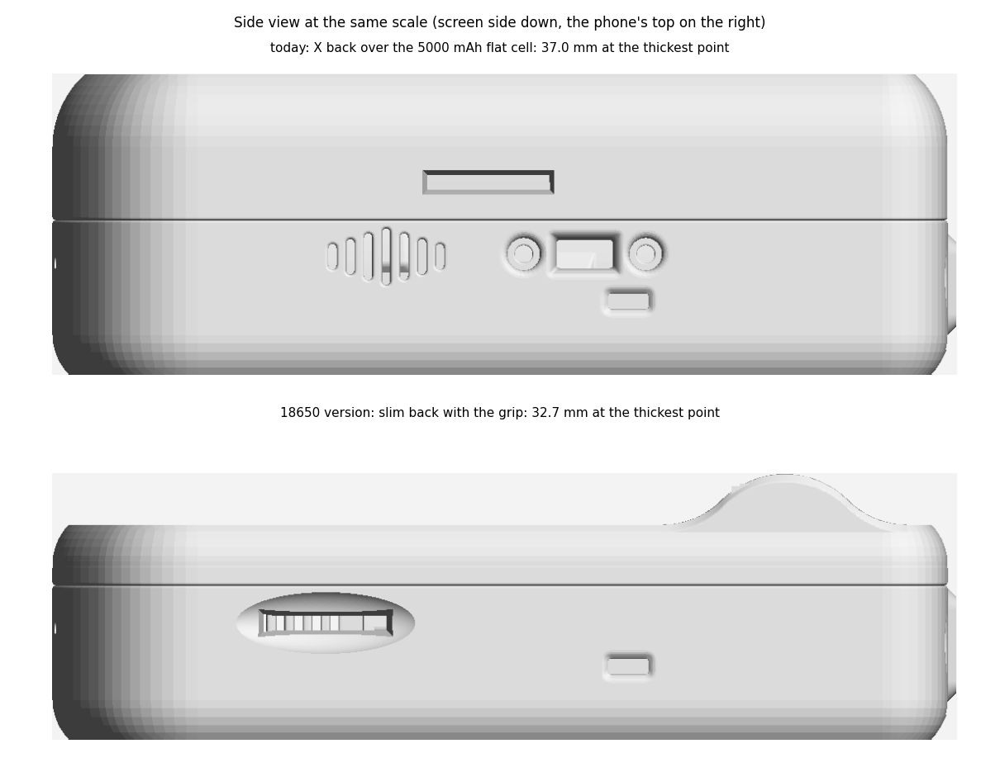
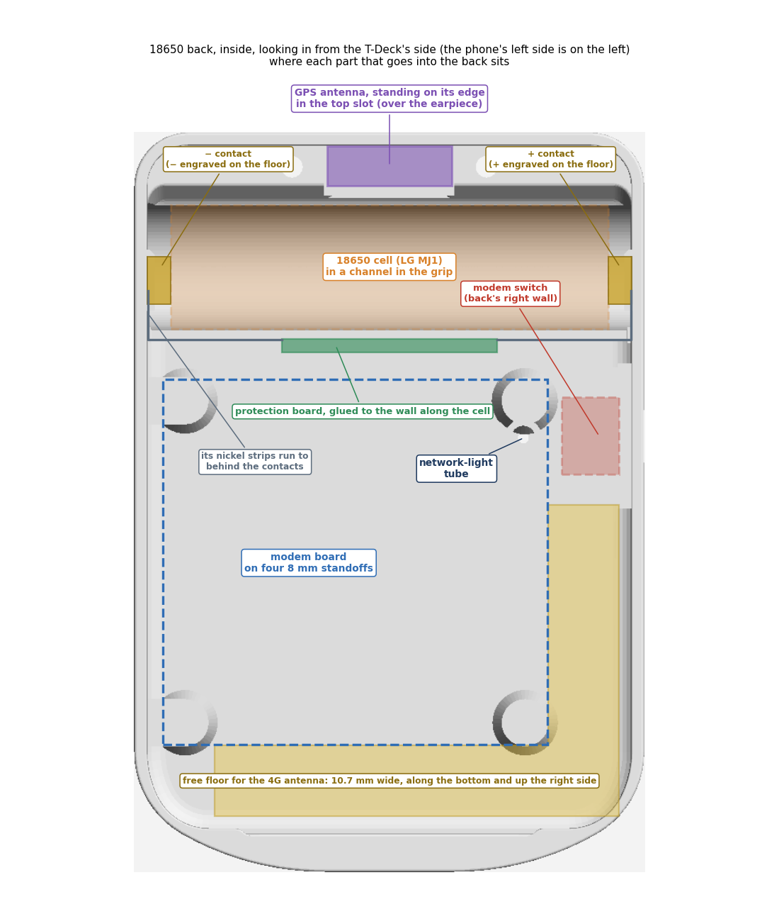
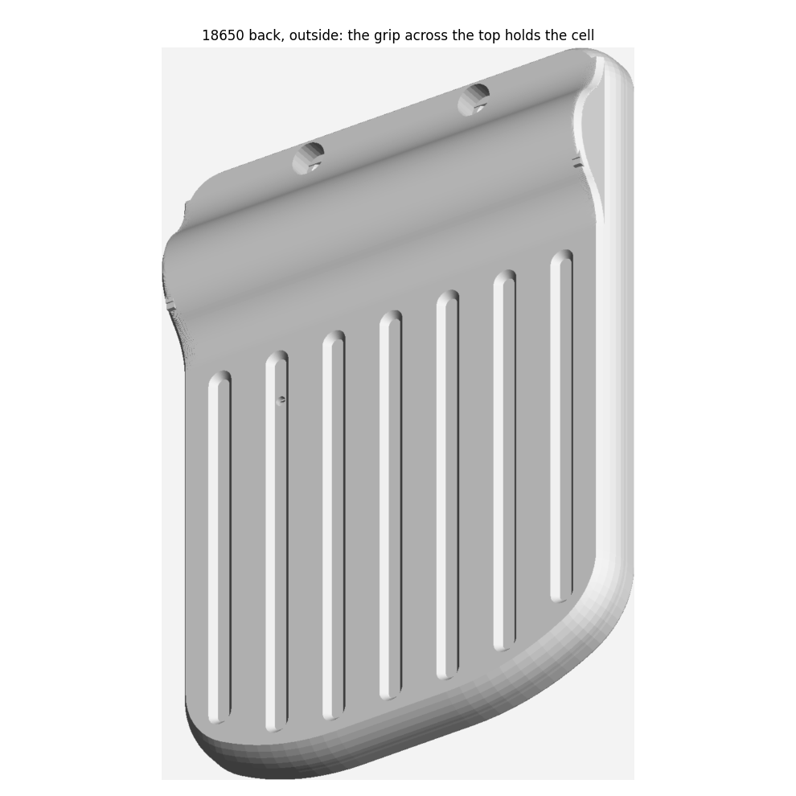
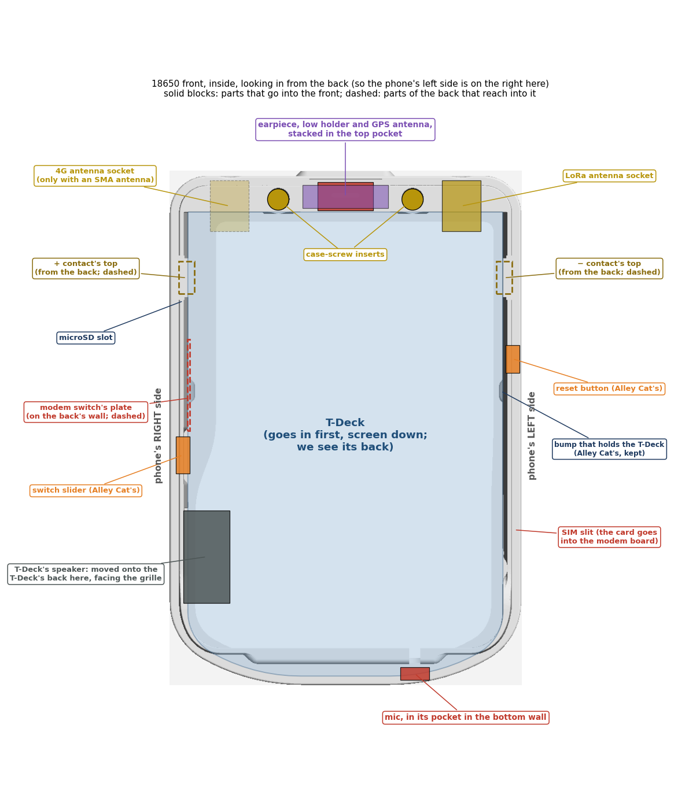
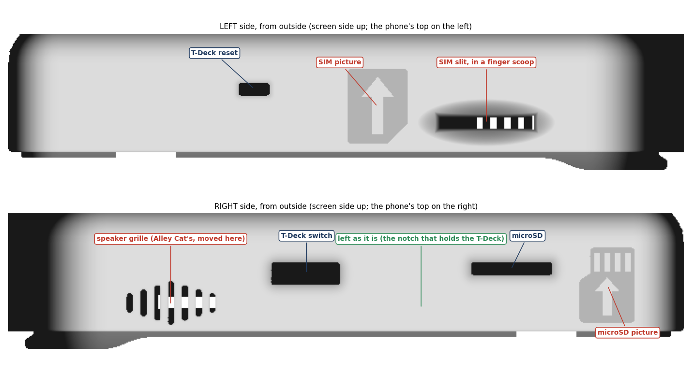
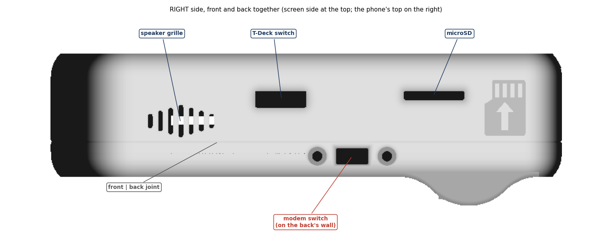
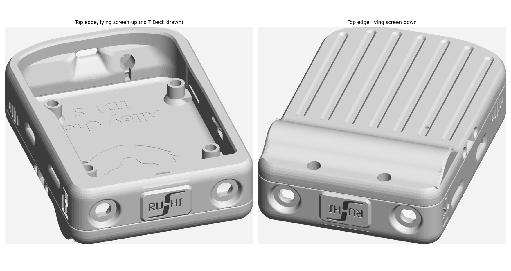
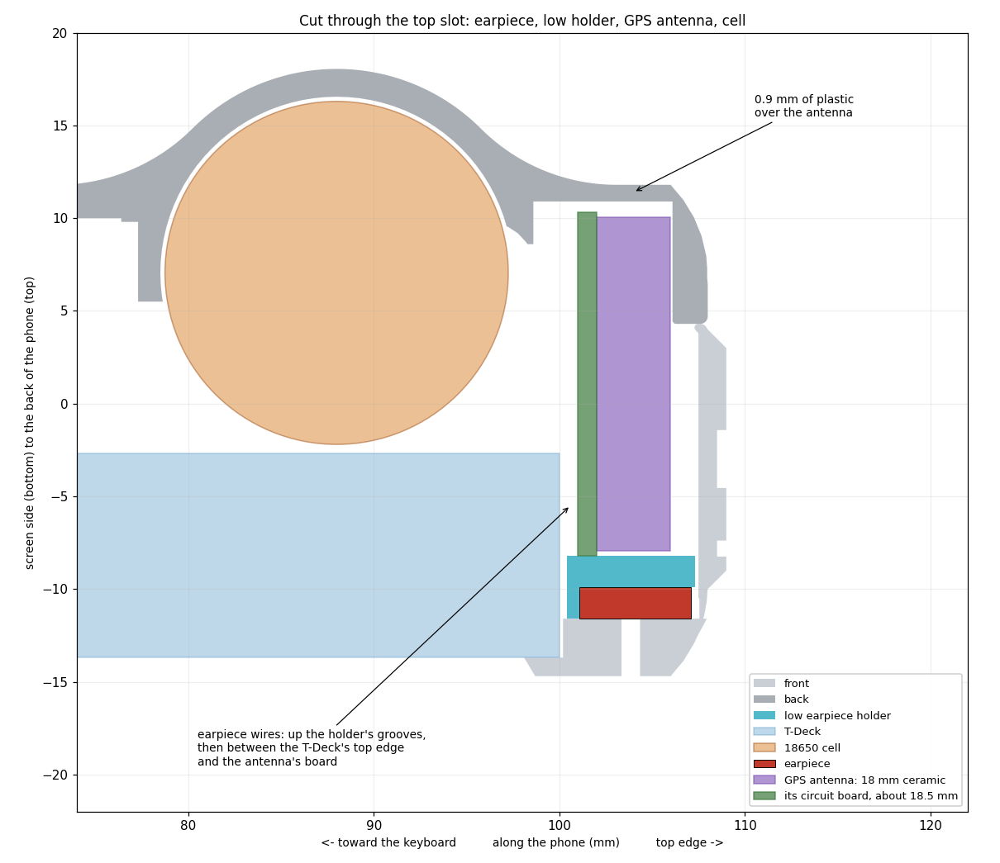
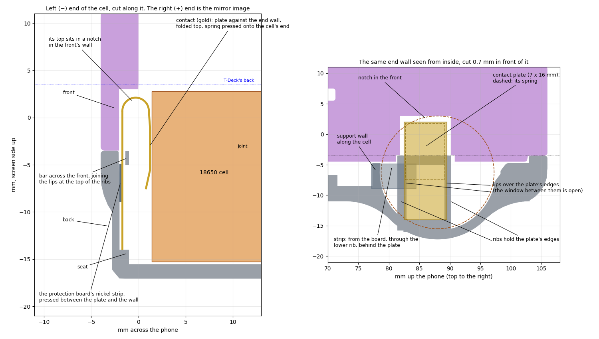

# 18650 version

**Status (12 Nov 2026): designed, and the print files are ready in [case/stl/18650/](../case/stl/18650/). Not printed
yet.** This is option 3 of the
[slim layout plan](slim-layout-plan.md), chosen on 9 Nov 2026. The scripts that make its three new parts are in
[case/scripts/](../case/scripts/). The battery contacts' holders were added on 12 Nov 2026, from the real contacts.
The GPS antenna hasn't arrived, so its slot is sized for the board we expect (see [GPS antenna](#gps-antenna)). The
antenna can go in later: the case opens with its two screws.

Until then, the other docs ([wiring.md](wiring.md), [assembly.md](assembly.md), [case.md](case.md) and the files in
case/stl/) still describe the current build: the X back with the 5000 mAh pouch over the modem board.

## At a glance

| | Current build | 18650 version |
|---|---|---|
| **Size** | 110 × 76 × 37 mm | 110 × 76 × **26.5 mm**, and **32.8 mm at the grip** |
| **Battery** | 5000 mAh pouch, lying on the modem board | One 18650 cell (LG MJ1, about 3400 mAh) across the top, inside a rounded grip |
| **Back** | Alley Cat's deep X back | Her slim S back, 0.5 mm deeper, with the grip added |
| **Modem board** | At the top, on 9 mm standoffs | Below the cell, on 8 mm standoffs |
| **GPS antenna** | KTRON 25 mm patch, bottom-left | Eteily 18 mm active antenna, standing on its edge in the top slot |
| **Modem switch** | Front, left side | Back, right wall, just below the grip |
| **SIM slit** | Back, left side | Front, left side, in a finger scoop |
| **Speaker grille** | Left side | Right side, below the T-Deck's switch (Alley Cat's same cavity and grille) |
| **Top-edge badge** | Alley Cat's cat | The rushiWorks logo. Her cat stays on the back's inside floor |
| **4G antenna** | Full-band sticker on the right side | Your choice. Space is kept free for it inside the back |

Sizes are at 100 %. The printed parts are 1 % larger (see [Printing](#printing)).



## The back





**Based on:** Alley Cat's slim S back (`Alley Chat TD1 S Inside Cat Edition.stl`), made **0.5 mm deeper**. That
gives 12.7 mm behind the T-Deck: 8 mm standoffs, the 1.6 mm board, the 1.5 mm SIM holder, and about 1.6 mm for the
wire joints on top.

**The grip:**
- **Shape:** a round ridge across the top of the back, 6.25 mm high, running the full width.
- **Sides:** blend into the flat back at no more than 45°, so the back prints standing up without supports outside.
- **The cell inside it:** the LG MJ1 (65.2 × 18.5 mm) lies across the phone in a channel, with 0.25 mm of play
  all round and 1.5 mm of plastic under it.
- **Its ends:** the channel runs wall to wall, 72 mm long. That leaves about 3.4 mm at each end of the cell for its
  contacts (see [Battery contacts](#battery-contacts)).
- **Case screws:** the two recesses are kept, cut through the grip.

**Modem board:**
- **Mounting:** four 8 mm standoffs with M3 heat-set inserts, below the cell. The board's top edge is 71.3 mm up from
  the bottom.
- **Free floor:** 10.7 mm below the board and 10.7 mm beside its right edge (yellow in the picture), kept empty for
  the 4G antenna.
- **Support wall:** a wall 4.5 mm tall runs along the cell's modem side. It holds the cell on that side, as the thick
  top block does on the other. Its face toward the cell is the channel's own curve carried on up, so the channel runs
  straight into it with no step, 0.25 mm from the cell all the way up. It's 1.2 mm thick at its thinnest. It stops 0.6 mm short of each end wall, leaving a
  slit for a nickel strip.
- **Protection board:** glued to the back of the support wall (see [Battery and power](#battery-and-power)).

**Other changes:**
- **Modem switch:** on the back's right wall, its top end level with where the grip starts.
  - **The cut-out:** Alley Cat's own slot and countersunk screw holes for the SS-12F15, copied from her front's left
    wall, carried through a 1.95 mm pad inside. The pad sets the switch deep enough that its 4 mm knob stands out
    only 0.1 mm, like Alley Cat's slider on the T-Deck's own switch, and keeps the switch clear of the front's lip,
    so the lip is whole. You slide it with a fingernail, as with the T-Deck's switch.
  - **Screws:** two M2 × 8 mm countersunk screws from outside, with nuts inside (6 mm is now too short).
  - **Thin spot:** there's about 1.4 mm of plastic between the knob slot and the joint, along the switch only.
- **Network light:** the same light tube and window as now. The window sits in an outside groove.
- **GPS top slot:** the gap between the two case-screw blocks is kept open, 19.5 mm wide, for the GPS antenna's top
  end. A 0.9 mm pocket in the floor gives it more height, leaving 0.9 mm of plastic outside.
- **Outside:** Alley Cat's grooves, each ending 2 mm short of the grip and 2 mm short of the bottom edge. No logo.
- **Inside:** Alley Cat's engraved cat and "Alley Chat TD1 S" stay on the floor, as her credit.

## The front







**Based on:** the current front (`make_front.py`), so the earpiece grille, mic pocket and antenna cut-outs are as
now.

**Left side:**
- **SIM slit:** 24–39 mm up from the bottom, lined up with the card holder on the board, which now sits at this
  height.
- **Finger scoop:** the slit sits in a shallow dish, 2.2 mm deep. The card's edge is about 2 mm below the bottom of
  the dish, so a fingernail can push it in and out.
- **SIM picture:** a 9.6 × 12 mm card outline beside the slit, showing which way it goes in.
- **A plain wall:** from 27.5 to 80 mm up, this wall is rebuilt in one piece from Alley Cat's own plain wall shape.
  Her speaker grille and switch mount are gone, inside and out, and the lip along the joint is unbroken. Only two
  openings are cut into it: the SIM slit and her reset opening, copied unchanged with the recess her reset button
  sits in. Her bump just above the reset, which holds the T-Deck's board down, is copied back unchanged too. Her
  rounded groove at 21–26 mm, which runs down beside the T-Deck's edge, is kept.

**Right side:**
- **Speaker:** Alley Cat's speaker cavity and grille, an exact copy, moved here below the T-Deck's switch, 15–36 mm
  up. The T-Deck's speaker goes in it. The cavity's lower edge comes down to the ridge the T-Deck snaps under, so the
  two line up, and 1.2 mm of wall is left between the cavity and the slot for the T-Deck switch's slider.
- **Left alone:** the stretch between the T-Deck's switch and the microSD slot. It has the notch that holds the
  T-Deck and the slot for the switch's slider piece.
- **microSD picture:** made larger (8.8 × 12 mm).

**Both sides:** a notch in the wall at each end of the cell, where the top of a battery contact stands above the joint
(see [Battery contacts](#battery-contacts)). About 2 mm of wall is left there.

**Top:**
- **Earpiece pocket:** widened from 16.4 to 19.5 mm above the earpiece, to match the GPS slot. Its floor is 0.5 mm
  lower, so the face under it is 3.1 mm instead of 3.6.
- **Badge:** 19.5 × 12 mm, the width of the GPS slot. It stops where the top edge starts to curve and stands 1 mm
  proud. It carries the rushiWorks logo (14.9 × 10.4 mm, engraved 0.5 mm deep).



## The low earpiece holder

The current holder, cut down, with the same cup and wire grooves. Its roof is flat, and the GPS antenna stands on it.

- **Roof:** 0.5 mm over the earpiece's folded contacts, leaving 0.2 mm for their solder.
- **Earpiece wires:** come up the holder's grooves, then pass between the T-Deck's top edge and the antenna's board
  to the space behind the T-Deck.



## GPS antenna

**Eteily ET-GPL12-5L15C-U-184:** an active GPS/GLONASS ceramic patch (18 × 18 × 4 mm), with a 15 cm cable and a
U.FL plug, 2.2–5 V, 5–15 mA, 28 dB gain. Two are ordered (quotation of 10 Nov 2026). Its supply comes from the
modem's GNSS socket (U.FL2): 3.0 V, the modem's default (`AT+CVAUXV?` reads 3000).

**It stands on its edge:** on the holder's roof, ceramic facing the phone's top edge. GPS passes through plastic, so
it needs no window.

**Room for it:**
- **Width:** 19.5 mm, for a board expected to be about 18.5 mm (by the same rule as the KTRON patch, whose board is
  larger than its "25 × 25" ceramic).
- **Height:** 19.1 mm, from the roof to the pocket in the back.
- **Thickness:** about 6 mm in all. The ceramic and board take about 5 mm.
  - **Amplifier on the back of the board:** turn the antenna so its amplifier is at the end toward the back cover.
    There's 2.4 mm there, but only about 1 mm beside the T-Deck's top edge, which the earpiece wires share.

**Check it when it arrives:** the board's size and thickness, and where its amplifier sits. Eteily hasn't sent a
drawing yet.

## 4G antenna

Your choice and your fitting. The free spaces inside the back are:
- the 10.7 mm band along the bottom, under the modem board;
- the right side, 17–52 mm up from the bottom, beside the board. The T-Deck's speaker sits about 6 mm above the
  lower part of it (16–36 mm up), in the front, so only a flat antenna fits there.

The full-band sticker used for the bench tests (110 × 20 mm) doesn't fit these. The SMA hole in the top-right corner
is still there for an external antenna.

## Battery and power

**The cell:** an LG MJ1 18650, about 3400 mAh, which is about two-thirds of the 5000 mAh pouch. It handles the modem's
2 A bursts easily. Buy a genuine one from a reputable seller.

**Which way round:** the cell's **+ end goes to the right** (the modem switch's side). A + and a − are engraved on
the floor beside the channel's ends.

**The circuit:** the same as [wiring.md](wiring.md), section 2, with the cell in place of the pouch:

```
 Cell contacts ──► nickel strips ──► protection board B+ / B−   (glued to the support wall)

 P+ ──┬── JST PH2.0 plug ────────────────────────────► T-Deck battery socket (+)
      └── modem switch (right wall): middle → outer pin ─► KTRON: + leg of C11 (470 µF)
 P− ──┬── JST PH2.0 plug ────────────────────────────► T-Deck battery socket (−)
      └──────────────────────────────────────────────► KTRON GND
```

**Protection board:** the 1S 3 A two-MOSFET board from Robu, 32 × 4–5 mm, with a nickel strip welded to each end
(91 mm overall). The T-Deck's charger charges the cell over USB-C, as now.
- **Where:** standing on the floor, glued to the back of the support wall with double-sided tape.
  - **Which way:** its chips face the wall, so the side marked P+ and P− faces the modem board, with B− on the left.
  - **Where along the wall:** centred, between the two small marks on the wall's top edge.
- **Its strips, with no soldering:** each strip runs along the wall to its end and through the slit there. It then
  turns along the end wall, passes through a slit in the contact's lower rib, and lies behind the contact's plate. The
  cell's spring presses the plate onto it.
  - **Length:** each strip needs about 28 mm to reach 2 mm behind its plate. They're about 29.5 mm long, so trim
    any extra.
  - **If a strip is too short:** solder a short piece of nickel strip or a wire onto its end, or solder a wire to the
    plate as a fallback.
- **Its outputs:** P+ goes to the switch's middle pin and the T-Deck plug's red wire. P− goes to the KTRON's GND and
  the plug's black wire. These are the only soldered joints at the battery.

## Battery contacts



**The contacts:** the two spring contacts from Robu's SMD 18650 holder. Each is a plate 7 mm wide and 16 mm tall. Its
top is folded down into a spring, 5 mm deep with the plate, that reaches 10 mm down. A 7 mm solder foot is bent out
at the bottom.

**How they sit:**
- **Upright against the end walls,** spring facing the cell and folded end up, as in the holder. The cell then
  slides in from above over the rounded folds.
- **Held by lips on the ribs, as in the holder:** the holder's end posts have a narrow groove for each edge of the
  plate. Here, the two ribs on each end wall, 7.2 mm apart, each have a lip that reaches 0.5 mm over the plate's front
  edge, 0.6 mm out from the wall: just room for the plate and the nickel strip behind it.
  - **Why it grips:** below its spring, the plate is stepped about 0.5 mm toward the back and has small tabs bent out
    at its sides. In the 0.6 mm groove, those bends press on both faces and hold the plate firmly. No glue is needed.
  - **The bar across the top:** a thin bar joins the two lips at the top of the ribs. The back prints standing on its
    top edge, and without the bar, one of the lips would start in mid-air. The plate's middle stays open for its
    spring.
- **Moved 2 mm toward the modem board** from the cell's centre line, so the protection board's strips can reach. The
  spring still covers the cell's + cap.
- **Bottom and top:** the plate's lower edge rests on a small seat. Its top then stands 1.5–2.4 mm above the joint,
  in a notch in the front's wall.
- **Spring pressure:** the plates are 72.0 mm apart. Each spring is pressed from 4.7 mm to about 3 mm, with the strip
  behind the plate. In the 1 % larger print, a 0.36 mm pad behind each plate keeps that the same.
- **The strip:** comes in through a thin slit in the lower rib and lies between the plate and the wall, in the
  groove (see [Battery and power](#battery-and-power)).

**Getting them ready:**
1. **Cut the solder foot off** at the bend, with side cutters, and file the edge smooth. Don't bend it inward: there
   are only about 3 mm between the plate and the cell's end, and nothing fits under the cell.
2. **Glue the protection board** to the support wall, then lead each strip through its slits to the end wall, so its
   end lies flat against the wall behind the lips.
3. **Push each plate down** behind the lips and the bar, in front of the strip, spring facing the cell, until it
   rests on the seat. It's a firm push: the plate's bends grip the groove.
4. **Put the cell in,** + end to the right. It presses the plates onto the strips.

## Wires inside

**Data wires:** the four wires (TX, RX, 3.3 V, GND) run from the modem board up the right side, past the cell's right
end, to the T-Deck's Grove pads. About 15 cm.

**Earpiece wires and the GPS cable:** from the top slot, past one end of the cell, to the modem board. The GPS cable
(15 cm) reaches the GNSS socket with plenty to spare.

**Room past the cell's ends:** about 3.4 mm in the back, plus 1.5–1.9 mm behind the T-Deck. At each contact, the
wires pass below its spring, in front of the lips that hold the contact. There's about 2.4 mm there, so they need
no grooves. Keep them clear of the spring and of the nickel strip.

**Mic:** as now. The pocket is in the front's bottom wall, and its wires go through the groove in the lip.

## Printing

**What to print:** built 1 % larger for ASA, like the current set. **Print them at 100 % in the slicer.** Each file is
already turned the way it prints.

| File | What it is | How it prints |
|---|---|---|
| [case/stl/18650/back-18650.stl](../case/stl/18650/back-18650.stl) | Back, with the grip | Standing on its top edge (111 mm tall), with a brim. The outside needs no supports. Inside, the standoffs, the channel under the cell and the support wall need a few supports, which stay hidden |
| [case/stl/18650/front-18650.stl](../case/stl/18650/front-18650.stl) | Front | Screen side down, no supports |
| [case/stl/18650/earpiece-holder-18650.stl](../case/stl/18650/earpiece-holder-18650.stl) | Low earpiece holder | On its T-Deck-side face, no supports |
| [case/stl/alley-chat-td1-switch.stl](../case/stl/alley-chat-td1-switch.stl) | Alley Cat's slider for the T-Deck's switch | As in the current set |
| [case/stl/alley-chat-td1-reset-button.stl](../case/stl/alley-chat-td1-reset-button.stl) | Alley Cat's reset button | As in the current set |
| [case/stl/alley-chat-td1-x-antenna-plug.stl](../case/stl/alley-chat-td1-x-antenna-plug.stl) | Alley Cat's antenna plug | Only if the top-right antenna hole stays empty |

**Print the back first.** It's the part most worth testing early: the grip, standing up on the bed, and the fit of
the cell, contacts and protection board. First layer standing up: about 64 × 4 mm, so use a brim of 5–8 mm.

## Making the files

Run these from the `case/` folder, with Alley Cat's original files beside it (see
[case/README.md](../case/README.md#making-the-files-again)):

```
python scripts/make_back_18650.py --scale 1.01 --stand "Alley Chat TD1 S Inside Cat Edition.stl" "Alley Chat TD1 Standard Front GPS Inserts.stl" stl/18650/back-18650.stl
python scripts/make_front_18650.py --scale 1.01 "Alley Chat TD1 Standard Front GPS Inserts.stl" stl/18650/front-18650.stl
python scripts/make_earpiece_holder_18650.py --scale 1.01 stl/18650/earpiece-holder-18650.stl
```

Without `--scale 1.01` they make the 100 % parts. `--stand` saves the back standing on its top edge, as it prints;
without it, the back keeps the design's position, which the pictures and checks use. The back script reads Alley
Cat's switch slot from her front file, which is why it needs both.

The pictures on this page are drawn from the 100 % parts by
[scripts/make_18650_pictures.py](scripts/make_18650_pictures.py).

## Before assembly

The modem's main functions (SIM, 4G with VoLTE, calls, SMS, GPS, earpiece and mic) are already proven on the bench,
and the capacitor swap is done. Only the checks that would mean opening the phone again come before assembly:

1. **Battery power** (the cell, holder and protection board have arrived):
   - **With the meter:** 3.6–4.2 V at the protection board's output, the right way round, and continuity from the
     modem's feed point to C11's + leg (not to VCC).
   - **Then on the battery,** through the switch: the modem answers `AT`, gives a battery reading (`AT+CBC`), and
     holds a call for about a minute without restarting.
2. **The four data wires,** with the meter and no power: each beeps from its Grove pad to its KTRON pad, and no two
   beep to each other.
3. **Optional:** the Eteily antenna gets a GPS fix near a window before it goes into the top slot.

Everything else is tested after assembly, through the T-Deck's USB-C.

## Still to do

1. **GPS antenna:** check its real size and where its amplifier sits (above).
2. **4G antenna:** your choice. The free spaces are listed above.
3. **Assembly steps:** write them for this version, after the back's test print.

**Things to watch after assembly:**
- **Wi-Fi and Bluetooth range:** the cell's steel can sits behind the T-Deck's Wi-Fi/Bluetooth antenna (top centre
  of its board), so their range may drop. Calls, 4G and LoRa aren't affected.
- **GPS:** the antenna sits near the T-Deck's ESP32 and the earpiece's magnet. Check the time to a fix and the number
  of satellites with the T-Deck running.
- **LoRa connector:** its tail in the top-left corner ends just above the cell's left end. At the dry fit, check that
  its cable lies flat there.

## Credits

The back, the front and the switch cut-out are changed versions of **"Lilygo T-Deck TD1 Case" by Alley Cat**
(Printables 741124), [CC BY-SA 4.0](https://creativecommons.org/licenses/by-sa/4.0/). The printed files are shared
under the same licence. Her cat and "Alley Chat TD1 S" stay engraved inside the back. The rushiWorks logo on the badge
isn't covered by either licence (see the [README](../README.md#licence)).
