# 18650 version

**Status (15 Nov 2026): designed, and the print files are ready in [case/18650/stl/](../case/18650/stl/). Not
printed yet.** The GPS antenna arrived on 15 Nov 2026 9 mm thick, and now has its room in a bump in the middle of the
top edge (see [GPS antenna](#gps-antenna)). This is option 3 of the
[slim layout plan](slim-layout-plan.md), chosen on 9 Nov 2026. The scripts that make its three new parts are in
[case/scripts/](../case/scripts/), built from Alley Cat's originals kept in
[case/alley-cat-originals/](../case/alley-cat-originals/). The battery contacts' holders were added on 12 Nov 2026, from the real contacts.

Until then, the other docs ([wiring.md](wiring.md), [assembly.md](assembly.md), [case.md](case.md) and the files in
case/x-back-5000mah/stl/) still describe the current build: the X back with the 5000 mAh pouch over the modem board.

## At a glance

| | Current build | 18650 version |
|---|---|---|
| **Size** | 110 × 76 × 37 mm | 110 × 76 × **26.5 mm**, and **32.8 mm at the grip**. The GPS bump stands 3.5 mm out from the top edge's middle |
| **Battery** | 5000 mAh pouch, lying on the modem board | One 18650 cell (LG MJ1, about 3400 mAh) across the top, inside a rounded grip |
| **Back** | Alley Cat's deep X back | Her slim S back, 0.5 mm deeper, with the grip added |
| **Modem board** | At the top, on 9 mm standoffs | Below the cell, on 8 mm standoffs |
| **GPS antenna** | KTRON 25 mm patch, bottom-left | Eteily 18 mm active antenna (9 mm thick), standing on its edge in the top slot and the GPS bump |
| **Modem switch** | Front, left side | Back, right wall, just below the grip |
| **SIM slit** | Back, left side | Front, left side, in a finger scoop |
| **Speaker grille** | Left side | Right side, below the T-Deck's switch (Alley Cat's same cavity and grille) |
| **Top edge** | Alley Cat's badge with her cat | The GPS bump, with the rushiWorks logo on the front's part and "rushiworks" on the back's. Her cat stays on the back's inside floor |
| **4G antenna** | Full-band sticker on the right side | A 41 × 12 mm flexible antenna along the bottom, inside. Backup: a 50 mm stubby in the top-right hole |

Sizes are at 100 %. The printed parts are 1 % larger (see [Printing](#printing)).

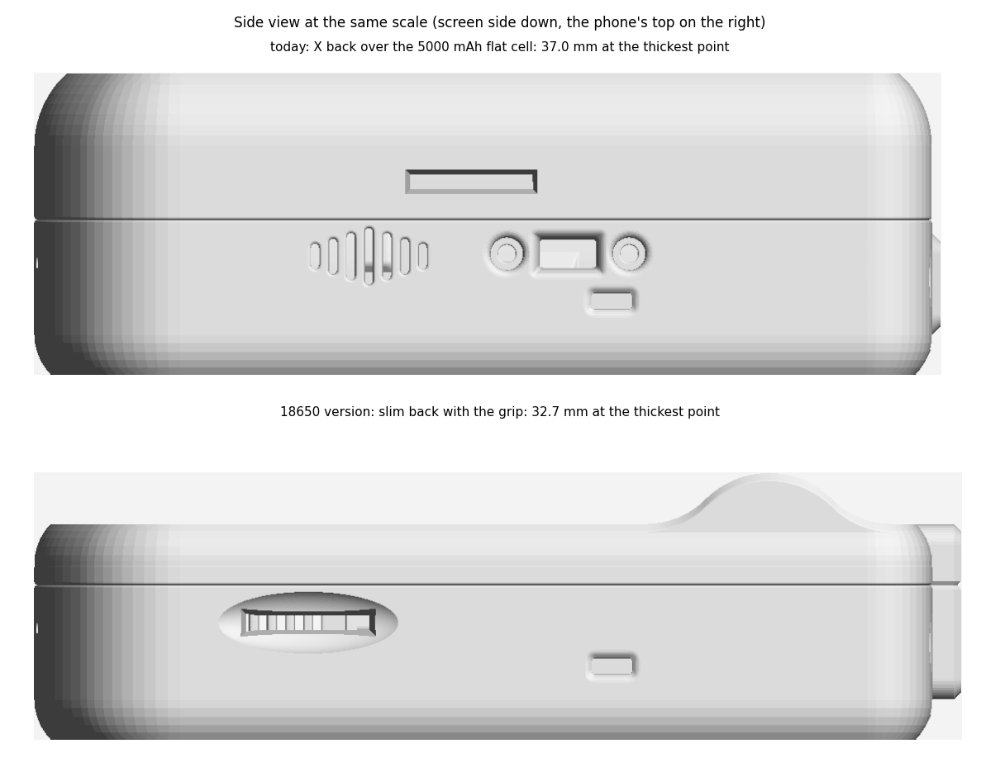

## The back

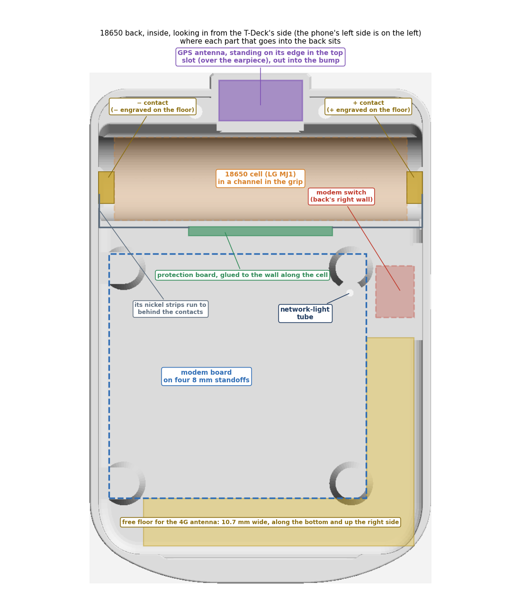

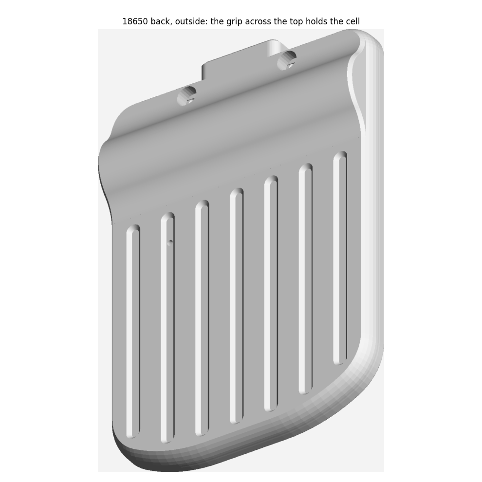

**Based on:** Alley Cat's slim S back (`Alley Chat TD1 S Inside Cat Edition.stl`), made **0.5 mm deeper**. That
gives 12.7 mm behind the T-Deck: 8 mm standoffs, the 1.6 mm board, the 1.5 mm SIM holder, and about 1.6 mm for the
wire joints on top.

**The grip:**
- **Shape:** a round ridge across the top of the back, 6.25 mm high, running the full width.
- **Sides:** blend into the flat back at no more than 45°, so the back prints standing up without supports outside.
- **The cell inside it:** the LG MJ1 (65.2 × 18.5 mm) lies across the phone in a channel, with 0.25 mm of play
  all round and 1.5 mm of plastic under it.
- **Its ends:** the channel runs wall to wall, 72 mm long. That leaves about 3.4 mm at each end of the cell for its
  contacts (see [Battery contacts](#battery-contacts)).
- **Case screws:** the two recesses are kept, cut through the grip.

**Modem board:**
- **Mounting:** four 8 mm standoffs with M3 heat-set inserts, below the cell. The board's top edge is 71.3 mm up from
  the bottom.
- **Free floor:** 10.7 mm below the board and 10.7 mm beside its right edge (yellow in the picture), kept empty for
  the 4G antenna.
- **Support wall:** a wall 4.5 mm tall runs along the cell's modem side. It holds the cell on that side, as the thick
  top block does on the other. Its face toward the cell is the channel's own curve carried on up, so the channel runs
  straight into it with no step, 0.25 mm from the cell all the way up. It's 1.2 mm thick at its thinnest. It stops 0.6 mm short of each end wall, leaving a
  slit for a nickel strip.
- **Protection board:** glued to the back of the support wall (see [Battery and power](#battery-and-power)).

**Other changes:**
- **Modem switch:** on the back's right wall, its top end level with where the grip starts.
  - **The cut-out:** Alley Cat's own slot and countersunk screw holes for the SS-12F15, copied from her front's left
    wall, carried through a 1.95 mm pad inside. The pad sets the switch deep enough that its 4 mm knob stands out
    only 0.1 mm, like Alley Cat's slider on the T-Deck's own switch, and keeps the switch clear of the front's lip,
    so the lip is whole. You slide it with a fingernail, as with the T-Deck's switch.
  - **Screws:** two M2 × 8 mm countersunk screws from outside, with nuts inside (6 mm is now too short).
  - **Thin spot:** there's about 1.4 mm of plastic between the knob slot and the joint, along the switch only.
- **Network light:** the same light tube and window as now. The window sits in an outside groove.
- **GPS top slot:** the gap between the two case-screw blocks is kept open, 19.5 mm wide, for the GPS antenna's top
  end. A 0.9 mm pocket in the floor gives it more height, leaving 0.9 mm of plastic outside. The slot runs on out
  through the top wall into the back's part of the GPS bump (see [GPS antenna](#gps-antenna)).
- **Outside:** Alley Cat's grooves, each ending 2 mm short of the grip and 2 mm short of the bottom edge. "rushiworks"
  is engraved on the GPS bump's back part.
- **Inside:** Alley Cat's engraved cat and "Alley Chat TD1 S" stay on the floor, as her credit.

## The front

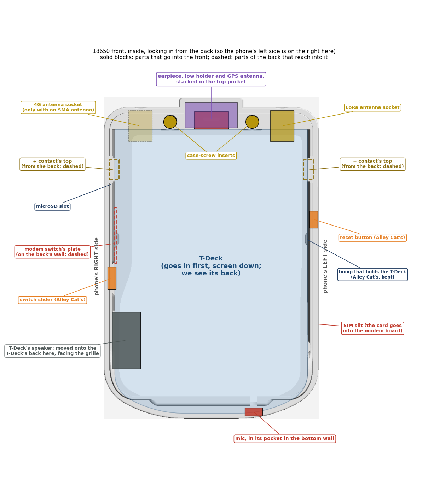

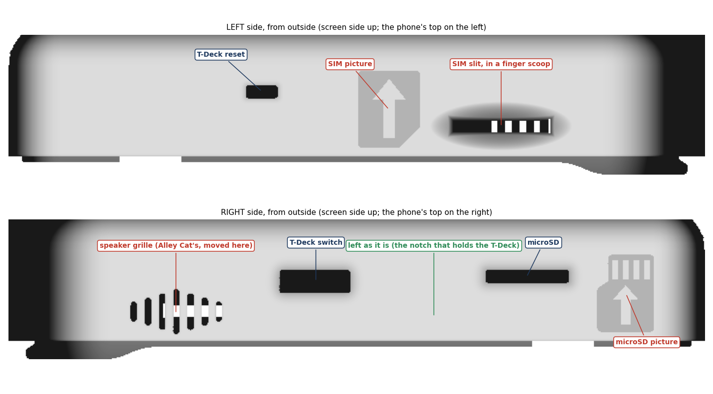

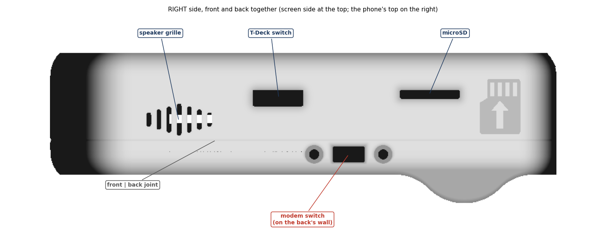

**Based on:** the current front (`make_front.py`), so the earpiece grille, mic pocket and antenna cut-outs are as
now.

**Left side:**
- **SIM slit:** 24–39 mm up from the bottom, lined up with the card holder on the board, which now sits at this
  height.
- **Finger scoop:** the slit sits in a shallow dish, 2.2 mm deep. The card's edge is about 2 mm below the bottom of
  the dish, so a fingernail can push it in and out.
- **SIM picture:** a 9.6 × 12 mm card outline beside the slit, showing which way it goes in.
- **A plain wall:** from 27.5 to 80 mm up, this wall is rebuilt in one piece from Alley Cat's own plain wall shape.
  Her speaker grille and switch mount are gone, inside and out, and the lip along the joint is unbroken. Only two
  openings are cut into it: the SIM slit and her reset opening, copied unchanged with the recess her reset button
  sits in. Her bump just above the reset, which holds the T-Deck's board down, is copied back unchanged too. Her
  rounded groove at 21–26 mm, which runs down beside the T-Deck's edge, is kept.

**Right side:**
- **Speaker:** Alley Cat's speaker cavity and grille, an exact copy, moved here below the T-Deck's switch, 15–36 mm
  up. The T-Deck's speaker goes in it. The cavity's lower edge comes down to the ridge the T-Deck snaps under, so the
  two line up, and 1.2 mm of wall is left between the cavity and the slot for the T-Deck switch's slider.
- **Left alone:** the stretch between the T-Deck's switch and the microSD slot. It has the notch that holds the
  T-Deck and the slot for the switch's slider piece.
- **microSD picture:** made larger (8.8 × 12 mm).

**Both sides:** a notch in the wall at each end of the cell, where the top of a battery contact stands above the joint
(see [Battery contacts](#battery-contacts)). About 2 mm of wall is left there.

**Top:**
- **Earpiece pocket:** Alley Cat's own pocket, 16.4 mm wide, whose side walls hold the earpiece holder. Its floor is
  0.5 mm lower, so the face under it is 3.1 mm instead of 3.6.
- **GPS slot above it:** one clean slot, 19.5 mm wide (as wide as the back's slot), running the full depth of the
  pocket and straight up through the top, then on out through the top wall into the GPS bump. On each side, a flat
  step level with the holder's roof, so the antenna stands on one flat surface.
- **GPS bump** (where Alley Cat's badge was): the front has its larger part, 14 mm of its 21.5 mm height, with the
  rushiWorks logo engraved on it (about 16 × 11 mm, 0.5 mm deep). See [GPS antenna](#gps-antenna).

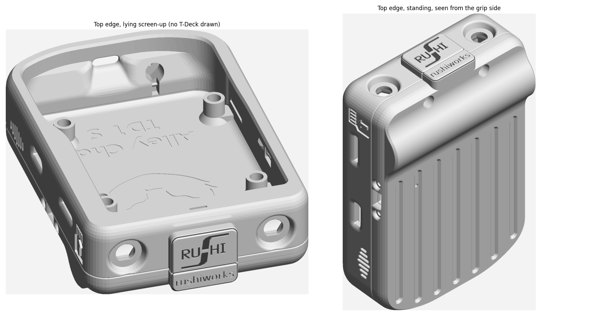

## The low earpiece holder

The current holder, cut down, with the same cup and wire grooves. Its roof is flat and level with the steps beside
it, and the GPS antenna stands on them.

- **Roof:** 0.5 mm over the earpiece's folded contacts, leaving 0.2 mm for their solder.
- **Earpiece wires:** come up the holder's grooves, then pass between the T-Deck's top edge and the antenna's metal
  cap (0.9 mm) to the space behind the T-Deck.

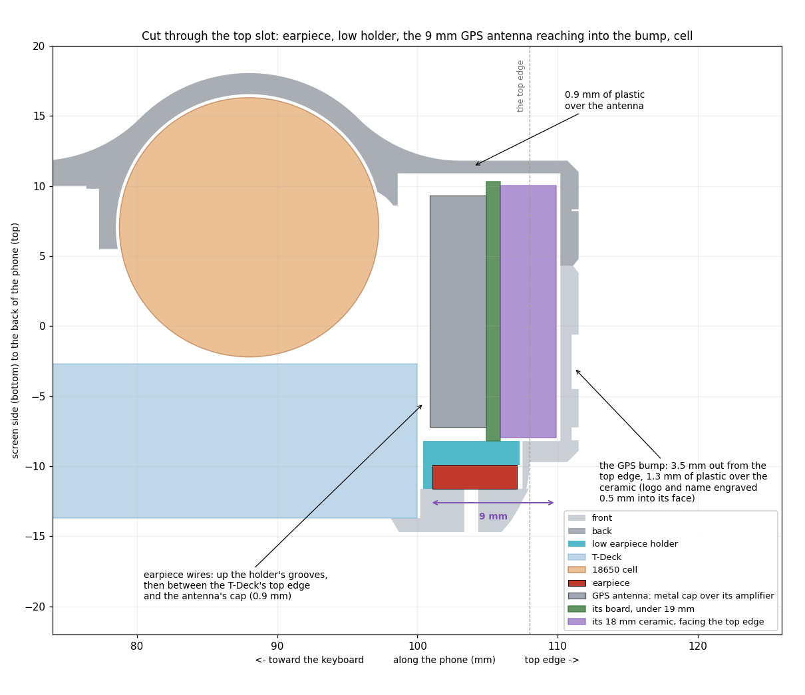

## GPS antenna

**Eteily ET-GPL12-5L15C-U-184:** an active GPS/GLONASS ceramic patch (18 × 18 × 4 mm), with a 15 cm cable and a
U.FL plug, 2.2–5 V, 5–15 mA, 28 dB gain. Two were ordered (quotation of 10 Nov 2026) and arrived on 15 Nov 2026.
Its supply comes from the
modem's GNSS socket (U.FL2): 3.0 V, the modem's default (`AT+CVAUXV?` reads 3000).

**It stands on its edge:** on the holder's roof, ceramic facing the phone's top edge, its metal cap toward the
T-Deck. GPS passes through plastic, so it needs no window.

**As it arrived (15 Nov 2026)** ([build log, with photos](build-log.md#3-gps-antenna-arrived-and-tested-15-nov-2026)):
- **Width and height:** under 19 mm, so the slot's 19.5 mm width is fine.
- **Thickness: 9 mm.** A metal cap over the amplifier covers almost the whole back of the board. The slot as first
  drawn had about 6 mm, so it was about 3 mm short.
- **Cable:** leaves from the middle of one side of the board.

**Tested (15 Nov 2026), at a window on the bench:** it works about as well as the KTRON patch: 35 satellites in the
position (KTRON on 5 Nov: 33), HDOP 1.24. It also works standing on its edge, the way it sits in the slot: 15–17
satellites used, the best four at 36–41 dB-Hz. Details in the
[build log](build-log.md#3-gps-antenna-arrived-and-tested-15-nov-2026).

**The GPS bump (decided 15 Nov 2026):** the antenna's room runs out through the top wall into a bump in the middle of
the top edge, where Alley Cat's badge was. Chosen over making the phone 3 mm longer, so the phone stays 110 mm long.
The scripts share it in [case/scripts/gps_bump_18650.py](../case/scripts/gps_bump_18650.py).
- **The room, along the phone:** 0.9 mm from the T-Deck's top edge for the earpiece wires, the antenna's 9 mm (cap
  4, board 1, ceramic 4), and 0.3 mm of play in front of the ceramic. Across: the slot's 19.5 mm. Up: 19.1 mm, from
  the holder's roof to the pocket in the back, 0.6 mm more than the board.
- **The bump:** 22.7 mm wide (a 1.6 mm wall beside the slot), 21.5 mm tall, from 1.5 mm under the antenna's foot to
  flush with the back's outside face, and 3.5 mm out from the top edge. That leaves 1.3 mm of plastic over the
  ceramic. Its corners seen end-on are rounded (2.5 mm), and its face has a 0.8 mm chamfer all round.
- **Split between the halves** at their joint: the front's part is 14 mm tall, the back's 7.5 mm. The joint's groove
  (each edge rounded in 0.4 mm) carries on across the bump, so the line round the phone doesn't stop at it.
- **Markings,** engraved 0.5 mm: the rushiWorks logo on the front's part (about 16 × 11 mm) and "rushiworks" on the
  back's part (19.5 mm long, letters about 2.9 mm tall). Both read the right way up with the phone lying screen-up,
  and when it stands seen from the grip side, as Alley Cat's badge did (the owner's choice of three).
- **Plastic over the antenna after engraving:** 0.8 mm in the letters, enough for GPS and for strength.
- **Its cable:** it leaves the middle of one side of the board, and a board under 19 mm leaves only about 0.5 mm
  beside it in the slot. So the antenna is pushed against the slot's right-hand side, leaving about 1 mm on the left,
  and a notch 1 mm into the front's slot wall on the phone's left gives the cable 2 mm. It runs from where the cable
  leaves the antenna to the slot's end at the T-Deck. The notch stops at 1 mm because the front's left case-screw
  insert is beside it: 1.25 mm of plastic is left (see [assembly](assembly-18650.md#2-heat-set-inserts) for setting
  that insert gently).

## 4G antenna

Two antennas, chosen on 12 Nov 2026: a small flexible one inside, tried first, and a stubby in the top-right hole as
the backup. Only one of them goes on the modem's 4G socket (U.FL1). The full-band sticker used for the bench tests
(110 × 20 mm) doesn't fit inside. Both are in the [parts list](../bom.md#18650-version-12-nov-2026).

**Inside, tried first: 41 × 12 mm flexible LTE antenna** (Rajiv Electronics, RESMA-41, ₹47)
- **What it is:** a flexible printed antenna that sticks on, with an 8 cm cable and a U.FL plug. There's no
  datasheet: the seller gives only "4G LTE and 2.4 GHz" and 4 dBi.
- **Where:** on the floor along the bottom, between the two lower standoffs, just below the modem board's lower edge.
  There are 45 mm of room there at its 12 mm width (checked on the back's model). Its lower edge lies on the curve
  where the floor meets the bottom wall, up to 1 mm high, which is fine for a thin, flexible antenna. Put its cable
  end on the right.
- **Cable:** plug it into U.FL1 before screwing the modem board down. The socket is on the board's underside, 3.6 mm
  in from its right edge. Lay any spare cable and other wires beside the antenna, not on it.
- **What to expect:** it is less than half the length of the sticker, so the signal will be weaker, most on the low
  bands (850 MHz, which Jio uses, and 900 MHz, which Airtel uses) and most indoors. A similar-sized antenna with a
  datasheet (Taoglas FXP40) measures about 25 % efficiency at 824–960 MHz.
- **Test it** after assembly ([test-18650.md](test-18650.md), step 5): at the bench spot where the sticker lying in
  the open read −91 dBm on band 5 (7 Nov 2026), the average of 5 readings with this antenna fitted. Within about
  5 dB (−96 dBm or better): keep it. Much weaker: fit the stubby.

**Outside, the backup: 50 mm right-angled stubby** (Lambdoid LWC-4G-RD-RA-SMA-PLUG-02, from Robu)
- **What it is:** 50 mm long and 10 mm across, SMA male. Its datasheet gives 698–960 and 1710–2690 MHz, which covers
  every Indian 4G band, and VSWR under 2. Same maker as the LoRa stubby.
- **Where:** screwed into the top-right SMA hole. Being right-angled, it lies along the phone's top edge instead of
  sticking up.
- **Cable:** the KTRON IPX → SMA cable you have (10 cm), from U.FL1 past the cell's right end to the hole. It needs
  roughly 9 cm, so check that it reaches at the dry fit. The 15 cm version (₹42) is the spare plan.
- **What to expect:** the stronger signal of the two, because it sits outside, away from the T-Deck's board and the
  cell.

**The top-right hole:** with only the inside antenna, close it with the GSM antenna plug from
[case/18650/stl/](../case/18650/stl/).

## Wiring

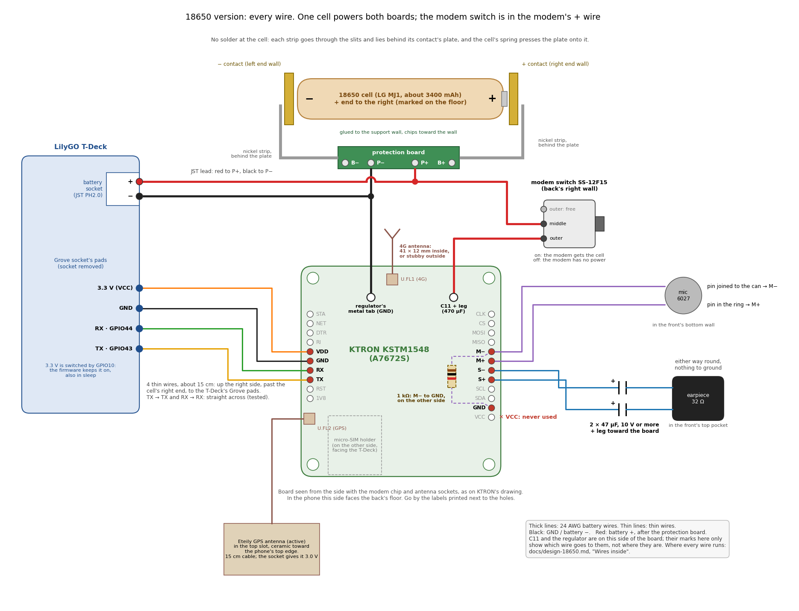

The connections are the same as in the current build ([wiring.md](wiring.md)). Only the battery side and the modem
switch's place change: they are explained under [Battery and power](#battery-and-power), and where each wire runs
under [Wires inside](#wires-inside).

## Battery and power

**The cell:** an LG MJ1 18650, about 3400 mAh, which is about two-thirds of the 5000 mAh pouch. It handles the modem's
2 A bursts easily. Buy a genuine one from a reputable seller.

**Which way round:** the cell's **+ end goes to the right** (the modem switch's side). A + and a − are engraved on
the floor beside the channel's ends.

**The circuit:** the same as [wiring.md](wiring.md), section 2, with the cell in place of the pouch:

```
 Cell contacts ──► nickel strips ──► protection board B+ / B−   (glued to the support wall)

 P+ ──┬── JST GH 1.25 mm plug ───────────────────────► T-Deck battery socket (+)
      └── modem switch (right wall): middle → outer pin ─► KTRON: + leg of C11 (470 µF)
 P− ──┬── JST GH 1.25 mm plug ───────────────────────► T-Deck battery socket (−)
      └──────────────────────────────────────────────► KTRON GND
```

**Protection board:** the 1S 3 A two-MOSFET board from Robu, 32 × 4–5 mm, with a nickel strip welded to each end
(91 mm overall). The T-Deck's charger charges the cell over USB-C, as now.
- **Where:** standing on the floor, glued to the back of the support wall with double-sided tape.
  - **Which way:** its chips face the wall, so the side marked P+ and P− faces the modem board, with B− on the left.
  - **Where along the wall:** centred, between the two small marks on the wall's top edge.
- **Its strips, with no soldering:** each strip runs along the wall to its end and through the slit there. It then
  turns along the end wall, passes through a slit in the contact's lower rib, and lies behind the contact's plate. The
  cell's spring presses the plate onto it.
  - **Length:** each strip needs about 28 mm to reach 2 mm behind its plate. They're about 29.5 mm long, so trim
    any extra.
  - **If a strip is too short:** solder a short piece of nickel strip or a wire onto its end, or solder a wire to the
    plate as a fallback.
- **Its outputs:** P+ goes to the switch's middle pin and the T-Deck plug's red wire. P− goes to the KTRON's GND and
  the plug's black wire. These are the only soldered joints at the battery.

## Battery contacts

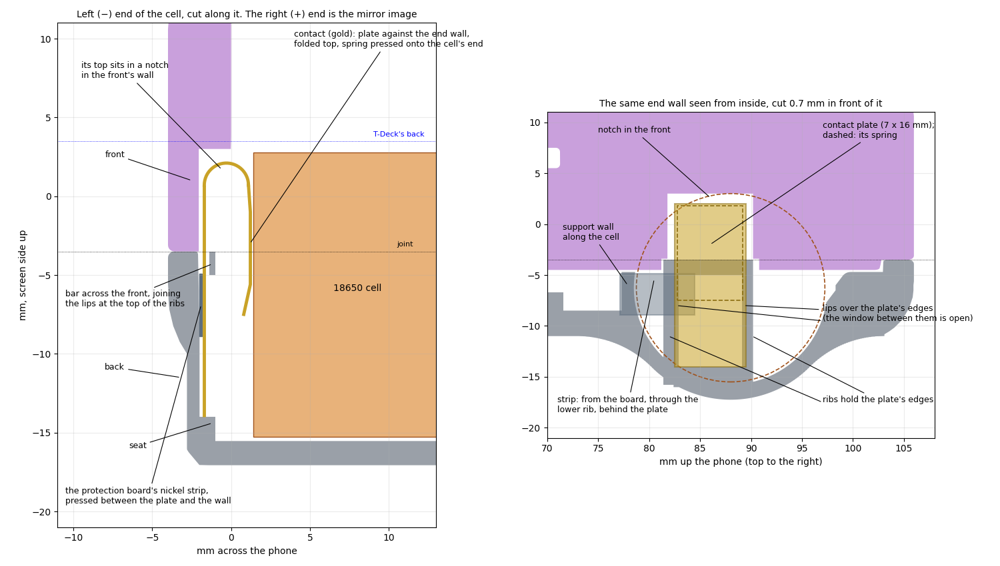

**The contacts:** the two spring contacts from Robu's SMD 18650 holder. Each is a plate 7 mm wide and 16 mm tall. Its
top is folded down into a spring, 5 mm deep with the plate, that reaches 10 mm down. A 7 mm solder foot is bent out
at the bottom.

**How they sit:**
- **Upright against the end walls,** spring facing the cell and folded end up, as in the holder. The cell then
  slides in from above over the rounded folds.
- **Held by lips on the ribs, as in the holder:** the holder's end posts have a narrow groove for each edge of the
  plate. Here, the two ribs on each end wall, 7.2 mm apart, each have a lip that reaches 0.5 mm over the plate's front
  edge, 0.6 mm out from the wall: just room for the plate and the nickel strip behind it.
  - **Why it grips:** below its spring, the plate is stepped about 0.5 mm toward the back and has small tabs bent out
    at its sides. In the 0.6 mm groove, those bends press on both faces and hold the plate firmly. No glue is needed.
  - **The bar across the top:** a thin bar joins the two lips at the top of the ribs. The back prints standing on its
    top edge, and without the bar, one of the lips would start in mid-air. The plate's middle stays open for its
    spring.
- **Moved 2 mm toward the modem board** from the cell's centre line, so the protection board's strips can reach. The
  spring still covers the cell's + cap.
- **Bottom and top:** the plate's lower edge rests on a small seat. Its top then stands 1.5–2.4 mm above the joint,
  in a notch in the front's wall.
- **Spring pressure:** the plates are 72.0 mm apart. Each spring is pressed from 4.7 mm to about 3 mm, with the strip
  behind the plate. In the 1 % larger print, a 0.36 mm pad behind each plate keeps that the same.
- **The strip:** comes in through a thin slit in the lower rib and lies between the plate and the wall, in the
  groove (see [Battery and power](#battery-and-power)).

**Getting them ready:**
1. **Cut the solder foot off** at the bend, with side cutters, and file the edge smooth. Don't bend it inward: there
   are only about 3 mm between the plate and the cell's end, and nothing fits under the cell.
2. **Glue the protection board** to the support wall, then lead each strip through its slits to the end wall, so its
   end lies flat against the wall behind the lips.
3. **Push each plate down** behind the lips and the bar, in front of the strip, spring facing the cell, until it
   rests on the seat. It's a firm push: the plate's bends grip the groove.
4. **Put the cell in,** + end to the right. It presses the plates onto the strips.

## Wires inside

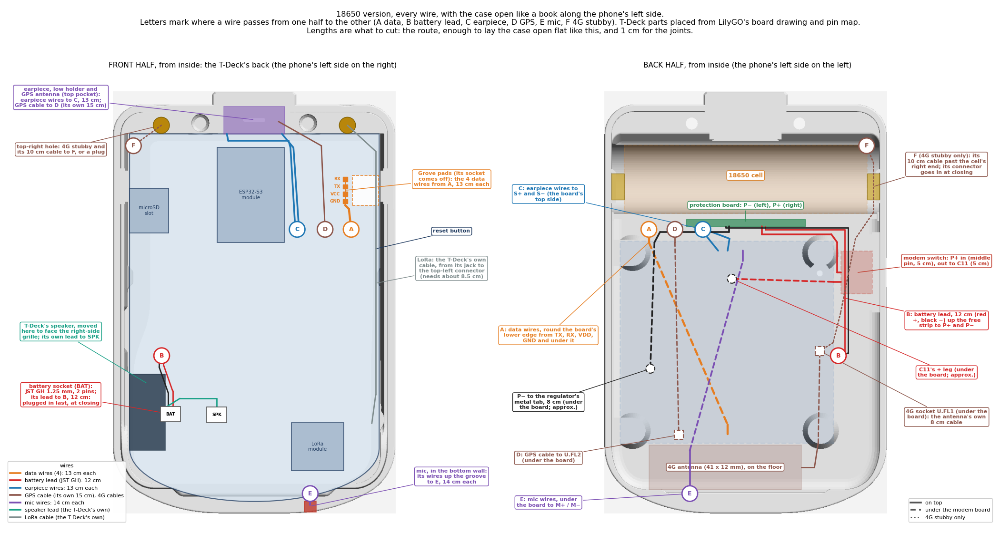

The T-Deck's connectors are placed from LilyGO's own board drawing (`shell/T-Deck.dxf` in their
[T-Deck repository](https://github.com/Xinyuan-LilyGO/T-Deck)) and its pin map
([wiki.lilygo.cc](https://wiki.lilygo.cc/products/t-deck-series/t-deck/)). Its reset button lands on the front's
reset opening, which confirms the placing.

**Data wires:** the four wires (TX, RX, 3.3 V, GND) leave their holes on the modem board's lower edge, go round that
edge and under the board, come up at its top-left corner, and run along the T-Deck's back to its Grove pads. The pads
are near the T-Deck's left edge, about 15 mm below its top edge, once its Grove socket is off. Cut to 13 cm each
(every wire's length is in [assembly-18650.md](assembly-18650.md#the-pictures)).

**Battery lead:** the T-Deck's battery socket is low on its back, near its right edge, beside the speaker's socket.
It's a **JST GH 1.25 mm** socket (LilyGO's pin map). The lead (12 cm) runs from it down the free strip on the right
side of the back, to P+ and P−. It crosses between the halves far from the side the case opens on, so it's plugged
in last, just before closing.

**Earpiece wires and the GPS cable:** from the top pocket, down the T-Deck's back to the left of its ESP32 module,
and into the back just below the cell. The earpiece wires go to S+ and S−. The GPS cable goes under the modem board
to its GNSS socket, using about 10 cm of its 15 cm.

**On the T-Deck's back:** lay the wires flat on its board, between its parts, never over them. The cell sits only
0.5 mm under the T-Deck's tallest parts.

**Past the cell's ends:** only the 4G stubby's cable, if it's used, passes the cell's right end. There's about
3.4 mm there; at the contact it passes below the spring, in front of the lips.

**Mic:** as now. The pocket is in the front's bottom wall, and its wires go through the groove in the lip.

## Printing

> **Print it in ASA only.** The files are built 1 % larger to allow for ASA's shrinkage; in PLA, PLA+ or PETG the
> parts would come out too large. ASA also takes the heat of a pocket or a car.

**What to print:** every piece is in [case/18650/stl/](../case/18650/stl/), built 1 % larger for ASA like the current
set. **Print them at 100 % in the slicer.** Each file is already turned the way it prints.

| File | What it is | How it prints |
|---|---|---|
| [case/18650/stl/back-18650.stl](../case/18650/stl/back-18650.stl) | Back, with the grip | Lying on its outside face, the owner's way (it can't stand on its top edge any more: the GPS bump is there). The grip touches the bed first, so the flat part of the back, with the bump's back part, sits about 6 mm up and needs supports under it. Inside, the standoffs, the channel under the cell and the support wall need a few supports too |
| [case/18650/stl/front-18650.stl](../case/18650/stl/front-18650.stl) | Front | Screen side down. The GPS bump's underside stands out 3.5 mm about 5 mm above the bed, so it needs a small support |
| [case/18650/stl/earpiece-holder-18650.stl](../case/18650/stl/earpiece-holder-18650.stl) | Low earpiece holder | On its T-Deck-side face, no supports |
| [case/18650/stl/alley-chat-td1-switch.stl](../case/18650/stl/alley-chat-td1-switch.stl) | Alley Cat's slider for the T-Deck's switch | As in the current set |
| [case/18650/stl/alley-chat-td1-reset-button.stl](../case/18650/stl/alley-chat-td1-reset-button.stl) | Alley Cat's reset button | As in the current set |
| [case/18650/stl/alley-chat-td1-x-antenna-plug-gsm.stl](../case/18650/stl/alley-chat-td1-x-antenna-plug-gsm.stl) | Alley Cat's antenna plug, for the 4G (GSM) hole, top-right | Only if that hole stays empty (an internal 4G antenna) |
| [case/18650/stl/alley-chat-td1-x-antenna-plug-lora.stl](../case/18650/stl/alley-chat-td1-x-antenna-plug-lora.stl) | The same plug, for the LoRa hole, top-left | Only if that hole stays empty |

**Print the back first.** It's the part most worth testing early: the grip, and the fit of the cell, contacts and
protection board.

## Making the files

Run these from the `case/` folder. Alley Cat's two original files are kept in
[case/alley-cat-originals/](../case/alley-cat-originals/) (see
[case/README.md](../case/README.md#making-the-files-again)):

```
python scripts/make_back_18650.py --scale 1.01 "alley-cat-originals/Alley Chat TD1 S Inside Cat Edition.stl" "alley-cat-originals/Alley Chat TD1 Standard Front GPS Inserts.stl" 18650/stl/back-18650.stl
python scripts/make_front_18650.py --scale 1.01 "alley-cat-originals/Alley Chat TD1 Standard Front GPS Inserts.stl" 18650/stl/front-18650.stl
python scripts/make_earpiece_holder_18650.py --scale 1.01 18650/stl/earpiece-holder-18650.stl
```

Without `--scale 1.01` they make the 100 % parts. The back is saved lying on its outside face, as it prints, which is
also the design's position the pictures and checks use. (`--stand` still saves it standing on its top edge, but that
is no longer how it prints.) The back script reads Alley Cat's switch slot from her front file, which is why it
needs both.

The pictures on this page are drawn from the 100 % parts by
[case/scripts/make_18650_pictures.py](../case/scripts/make_18650_pictures.py). The wiring picture is drawn by
[docs/scripts/make_wiring_pictures.py](scripts/make_wiring_pictures.py), which also draws the bench wiring picture.

## Testing

The modem's main functions (SIM, 4G with VoLTE, calls, SMS, GPS, earpiece and mic) are already proven on the bench,
and the capacitor swap is done. Everything else is tested in one round after assembly (decided 13 Nov 2026), through
the T-Deck's USB-C with the [test program](../firmware/test-program/README.md): see
[test-18650.md](test-18650.md). The meter checks happen during assembly: the power wiring before it goes in, the
contacts, the data wires once soldered, and the switch before closing.

The case opens with its two screws, so a problem found in testing means opening it again, not reprinting.

## Still to do

1. **GPS antenna:** done. It arrived, was tested, and fits in the GPS bump (above).
2. **4G antenna:** fit the 41 × 12 mm antenna and test its signal. The stubby is the backup ([above](#4g-antenna)).
3. **Assembly steps:** drafted in [assembly-18650.md](assembly-18650.md). Check them at the dry fit after the back's
   test print.

**Things to watch after assembly:**
- **Wi-Fi and Bluetooth range:** the cell's steel can sits behind the T-Deck's Wi-Fi/Bluetooth antenna (top centre
  of its board), so their range may drop. Calls, 4G and LoRa aren't affected.
- **GPS:** the antenna sits near the T-Deck's ESP32 and the earpiece's magnet. Check the time to a fix and the number
  of satellites with the T-Deck running.
- **LoRa connector:** its tail in the top-left corner ends just above the cell's left end. At the dry fit, check that
  its cable lies flat there.

## Credits

The back, the front and the switch cut-out are changed versions of **"Lilygo T-Deck TD1 Case" by Alley Cat**
(Printables 741124), [CC BY-SA 4.0](https://creativecommons.org/licenses/by-sa/4.0/). The printed files are shared
under the same licence. Her cat and "Alley Chat TD1 S" stay engraved inside the back. The rushiWorks logo and name on the GPS bump
aren't covered by either licence (see the [README](../README.md#licence)).
