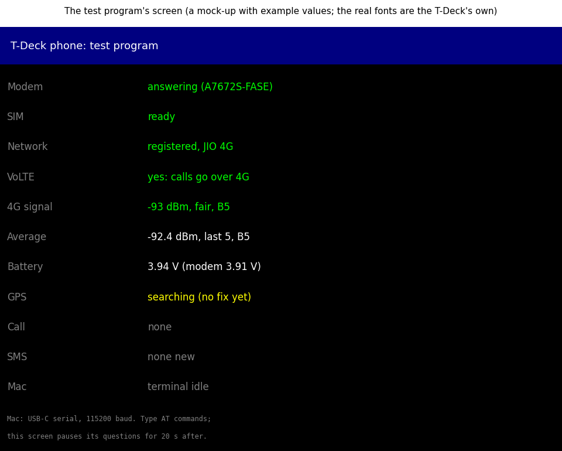

# Test program

A small T-Deck program for testing the assembled phone. Once the case is closed, the modem can only be reached
through the T-Deck. This program shows the modem's state on the T-Deck's screen, and passes a terminal on the Mac
(over the T-Deck's USB-C) straight through to the modem, so every AT command in [bring-up.md](../../docs/bring-up.md)
still works.

**Status (13 Nov 2026): written, and it builds. Not run on the T-Deck yet:** it gets loaded on test day, after
assembly.

## What the screen shows

The rows refresh every few seconds. Green is good, yellow means waiting or worth a look, red means a problem.

| Row | What it means | Good |
|---|---|---|
| Modem | Whether the modem answers | "answering (A7672S...)". "No answer" means the modem switch is off, or a data wire is wrong |
| SIM | The SIM card | "ready". "Not found": take the card out and push it in again with the modem off, then switch it on |
| Network | Registration on 4G, and the operator | "registered, JIO 4G" (or your operator) |
| VoLTE | Whether calls can go over 4G | "yes: calls go over 4G" |
| 4G signal | The latest reading (RSRP) and the band (B5 = band 5) | above −100 dBm |
| Average | The average of the last 5 readings on one band: the number for the 4G antenna test | within about 5 dB of the antenna lying in the open |
| Battery | The T-Deck's own reading, and the modem's in brackets | both about 3.6–4.2 V, and close to each other |
| GPS | Whether it has a position (never the position itself) | "fix, N satellites", near a window or outdoors |
| Call | Ringing, in a call, ended | "in a call, on 4G (VoLTE)" |
| SMS | A new message has arrived | "new: AT+CMGR=n reads it" |
| Mac | Whether the Mac's terminal is in use | after typing, the screen stops asking the modem for 20 s |

**Privacy:** the screen never shows a phone number, the IMEI, the SIM's number or a GPS position, so it can be
photographed for the build log. The Mac's terminal does show them.

**Speaker:** two beeps when the program starts, and two on every ring. That tests the T-Deck's speaker in its new
grille, and serves as the ringtone.

**When it starts or the modem is switched on,** it sets the modem up for testing:
- the modem repeats what's typed;
- the caller's number comes with each ring;
- SMS are text, and announced when they arrive;
- call sound goes to the earpiece, at volume 5 and mic gain 4 (the levels found right on the bench);
- GPS is switched on.

## The Mac's terminal

Plug the T-Deck into the Mac with USB-C and open a serial terminal on it at **115200 baud**. Everything typed goes
to the modem, and its replies come back. For example:
- `AT+CPSI?`: the network and the signal;
- `AT+CBC`: the modem's battery reading;
- `ATD+91XXXXXXXXXX;`: call a number;
- `AT+CHUP`: hang up.

The modem's own messages (`RING`, `+CLIP:`, `VOICE CALL: BEGIN`, a new SMS) appear even while nobody types.

## Loading it, and putting Meshtastic back

Loading this program replaces Meshtastic on the T-Deck, and can wipe Meshtastic's saved settings. So, on test day:

1. **Back up Meshtastic's settings** over USB with the Meshtastic command-line tool (`meshtastic --export-config`),
   to a file kept on the Mac. It holds the node's private key, so it never goes into this repository.
2. **Load the test program:** from this folder, `pio run -t upload` (PlatformIO).
3. **Run the tests.**
4. **Put Meshtastic back:** flasher.meshtastic.org in Chrome, choosing the T-Deck, then restore the settings with
   `meshtastic --configure <the backup file>`.

## How it works

- **Pins:** GPIO10 on (the T-Deck's peripheral power, which also feeds the modem board's VDD through the Grove
  3.3 V). The modem on GPIO43 (to the modem) and GPIO44 (from it), 115200 baud. The battery on GPIO4, through a 1:2
  divider. The speaker's amplifier (MAX98357A) on I2S: GPIO7, 5 and 6. The pins and the display's start-up come from LilyGO's own T-Deck examples
  (github.com/Xinyuan-LilyGO/T-Deck).
- **One question at a time:** the program asks the modem one thing every 0.7 s (AT, SIM, operator, network, VoLTE,
  signal, battery, GPS) and goes round again. It stops asking while the Mac's terminal is in use.
- **Signal:** `AT+CPSI?` gives RSRP. This board's firmware reports it as a number from 0 to 97, which is dBm + 140
  (found on the bench). The program also accepts plain dBm, in case the firmware changes.
- **Building:** PlatformIO, with the settings in `platformio.ini`: the same ESP32 platform version as LilyGO's
  examples, and the TFT_eSPI display library.
